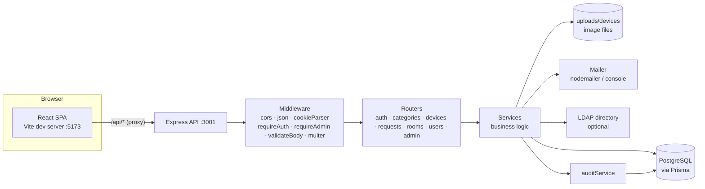
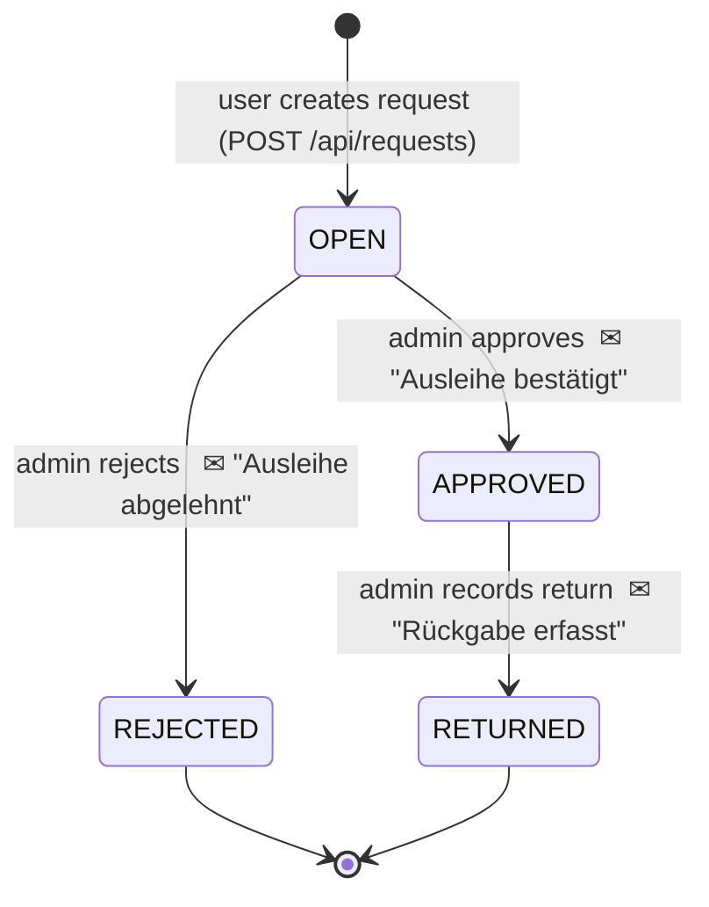
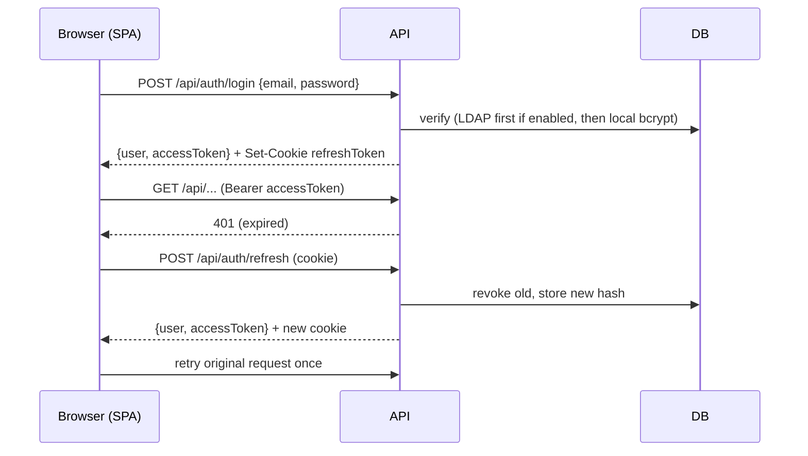

# LendLine — Project Documentation

> Internal IT equipment lending system ("IT-Geräteausleihe").
> Users search for free device units in a time window and request them for a room; administrators ("Verwaltung") approve or reject requests and record returns. Status changes trigger e-mails, and every administrative action is written to an audit log.

The UI, API error messages, e-mails and README are in **German**. This document is in English and quotes German UI terms where it helps to find them in the code.

---

## Table of contents

1. [At a glance](#1-at-a-glance)
2. [Repository layout](#2-repository-layout)
3. [Getting started](#3-getting-started)
4. [Configuration (environment variables)](#4-configuration-environment-variables)
5. [Architecture](#5-architecture)
6. [Domain model & database](#6-domain-model--database)
7. [Business rules & lifecycles](#7-business-rules--lifecycles)
8. [Authentication & authorization](#8-authentication--authorization)
9. [REST API reference](#9-rest-api-reference)
10. [Backend internals](#10-backend-internals)
11. [E-mail notifications](#11-e-mail-notifications)
12. [Audit log](#12-audit-log)
13. [Frontend](#13-frontend)
14. [Migration history](#14-migration-history)
15. [Known issues, gaps & inconsistencies](#15-known-issues-gaps--inconsistencies)
16. [Glossary (German → English)](#16-glossary-german--english)

---

## 1. At a glance

| Aspect   | Details                                                                                                                                |
| -------- | -------------------------------------------------------------------------------------------------------------------------------------- |
| Backend  | Node.js ≥ 20, TypeScript, Express 4, Prisma 6 (PostgreSQL), Zod, JWT, bcrypt, ldapts, multer, nodemailer                               |
| Frontend | React 19, React Router 7, Vite 7, TypeScript, plain CSS (no UI library)                                                                |
| Database | PostgreSQL 16 (via `docker-compose.yml`)                                                                                               |
| Auth     | Short-lived JWT access token (in memory) + rotating refresh token (httpOnly cookie); optional LDAP/Active Directory                    |
| Roles    | `USER` (borrower, "Nutzer") and `ADMIN` ("Verwaltung")                                                                                 |
| Ports    | API `127.0.0.1:3001`, frontend dev server `127.0.0.1:5173` (proxies `/api` to the API)                                                 |
| Quality  | TypeScript 7 (strict), oxlint (incl. type-aware rules), oxfmt, Prettier (MD/JSON/YAML), knip — see §3 “Code quality”                   |
| Tests    | None                                                                                                                                   |
| VCS      | The folder is not a git repository (a `.gitignore` exists). The `.venv`/`.idea` folders come from PyCharm and are not used by the app. |

---

## 2. Repository layout

```
LendLine/
├── README.md                  German quick-start (partly outdated, see §15)
├── docker-compose.yml         PostgreSQL 16 container (user/pass/db = lendline)
├── .gitignore                 node_modules, dist, .env, backend/uploads, .idea, .venv
├── package.json               Root scripts: check (everything), format:docs (Prettier)
├── .oxfmtrc.json              Code formatting (oxfmt), used by the backend
├── .prettierignore            Prettier formats only Markdown/JSON/YAML
├── doc/                       This documentation
│
├── backend/
│   ├── .env / .env.example    Runtime configuration
│   ├── package.json           ESM ("type": "module"); scripts: dev, start, build, typecheck, lint*, format*, knip, check, prisma:*
│   ├── tsconfig.json          Type-check config: NodeNext/ESM, ES2024, strict (+ noUncheckedIndexedAccess …)
│   ├── tsconfig.build.json    Emitting config (rootDir src → dist/)
│   ├── .oxlintrc.json         Lint rules
│   ├── knip.json              Unused files/exports/dependencies
│   ├── prisma/
│   │   ├── schema.prisma      Data model
│   │   ├── seed.ts            Demo users, categories, devices
│   │   └── migrations/        9 SQL migrations (2026-09-23)
│   ├── uploads/devices/       Uploaded device images (served statically)
│   └── src/
│       ├── index.ts           Starts the HTTP server
│       ├── app.ts             Express app, middleware, route mounting, admin endpoints
│       ├── config.ts          Reads & validates environment variables
│       ├── lib/               prisma client, HttpError, bcrypt, JWT/refresh tokens, asyncHandler, routeParam
│       ├── middleware/        auth (requireAuth/requireAdmin), validateBody, upload (multer), errorHandler
│       ├── validators/        Zod schemas for auth, devices, requests
│       ├── routes/            auth, categories, devices, requests, rooms, users
│       ├── services/          Business logic (one file per area)
│       └── emails/            mailer, HTML layout/escaping, 3 templates
│
└── frontend/
    ├── index.html
    ├── vite.config.ts         Dev server on 127.0.0.1:5173, /api → http://localhost:3001
    ├── package.json           Scripts: dev, build, preview, typecheck, lint*, format*, knip, check
    ├── tsconfig.json          Single config for src/ and vite.config.ts (strict)
    ├── .oxlintrc.json / .oxfmtrc.json / knip.json
    └── src/
        ├── main.tsx           BrowserRouter + AuthProvider + global CSS
        ├── App.tsx            Route table + route guards
        ├── types.ts           Shared types, status labels, date formatting
        ├── api/client.ts      fetch wrapper with bearer token + auto refresh (one shared refresh request)
        ├── api/useApi.ts      Data-loading hook: { data, error, reload }
        ├── auth/AuthContext.tsx
        ├── components/        Layout, ui (PageHeader, Field, Alert, Modal), icons, CategorySelect, DeviceImages (+ calendar dialogs), StatusBadge
        ├── pages/             One file per screen (user + admin)
        └── styles/global.css
```

---

## 3. Getting started

### Prerequisites

- Node.js 20+
- Docker (for PostgreSQL) or an existing PostgreSQL 16 instance

### First-time setup

```bash
# 1. Database
docker compose up -d

# 2. Backend
cd backend
copy .env.example .env          # Windows; use `cp` on Linux/macOS — then change the JWT secrets
npm install
npx prisma migrate deploy       # apply all migrations
npm run prisma:seed             # demo users, categories, devices
npm run dev                     # tsx watch → http://localhost:3001

# 3. Frontend (second terminal)
cd frontend
npm install
npm run dev                     # http://localhost:5173
```

### Demo accounts (created by `prisma/seed.ts`)

| Role                    | E-mail                 | Password     |
| ----------------------- | ---------------------- | ------------ |
| Admin ("IT-Verwaltung") | `admin@lendline.local` | `Admin123!`  |
| User ("Max Mustermann") | `user@lendline.local`  | `User12345!` |

The seed also creates the categories _Laptop, Monitor, Beamer, Zubehör_ and five devices with one unit each (the Epson projector unit `BM-3001` is seeded as `DEFECTIVE`). The seed is idempotent (upserts / "create if missing by name").

Rooms are **not** in the seed; the `rooms` migration inserts `A101`, `B204`, `C12` and a placeholder `Nicht zugeordnet` (`room-unassigned`).

### npm scripts

| Location | Script                                               | Purpose                                                                   |
| -------- | ---------------------------------------------------- | ------------------------------------------------------------------------- |
| root     | `check`                                              | Runs `check` in backend and frontend, then `format:docs`                  |
| root     | `format:docs` / `format:docs:fix`                    | Prettier check / fix for `*.{json,md,yml,yaml}`                           |
| backend  | `dev`                                                | `tsx watch src/index.ts` (hot reload, **no type check**)                  |
| backend  | `start`                                              | `tsx src/index.ts`                                                        |
| backend  | `build`                                              | `tsc -p tsconfig.build.json` → `dist/`                                    |
| backend  | `prisma:generate` / `prisma:migrate` / `prisma:seed` | Prisma helpers                                                            |
| backend  | `db:setup`                                           | `prisma migrate dev --name init` + seed (legacy; prefer `migrate deploy`) |
| frontend | `dev` / `build` / `preview`                          | Vite; `build` runs `tsc --noEmit` first                                   |
| both     | `typecheck`                                          | `tsc --noEmit`                                                            |
| both     | `lint` / `lint:fix`                                  | oxlint, `--max-warnings 0`                                                |
| both     | `lint:types`                                         | oxlint with type-aware rules (`oxlint-tsgolint`), reports unused disables |
| both     | `format` / `format:fix`                              | oxfmt check / fix for code                                                |
| both     | `knip`                                               | Unused files, exports and dependencies                                    |
| both     | `check`                                              | `typecheck` + `lint:types` + `format` + `knip`                            |

### Code quality

Adopted from a shared lint bundle and adapted to this project (2026-09-24). Run everything with
`npm run check` in the repository root; all checks pass with zero warnings.

- **One file, one formatter:** oxfmt formats code (`.ts/.tsx`), Prettier only Markdown/JSON/YAML.
  The backend uses the root `.oxfmtrc.json`; the frontend has its own with a React import group.
  Imports are sorted automatically: type imports, (React), external, internal, relative.
- **TypeScript:** both sides run `strict` plus `noUncheckedIndexedAccess`, `noImplicitReturns`,
  `noImplicitOverride`, `verbatimModuleSyntax` (type-only imports must use `import type`),
  `erasableSyntaxOnly`. The backend is **ESM** (`module: NodeNext`), so relative imports end in
  `.js` (`import { x } from "./y.js"`), even though the source file is `y.ts`.
- **Project-specific lint decisions** (commented in the `.oxlintrc.json` files):
  - `node/no-process-env` is off only for `src/config.ts`, the single place that reads env
    variables. Its `env()` helper treats empty values (`SMTP_HOST=`) as unset.
  - `no-underscore-dangle` allows `_count`/`_all` (Prisma's aggregation API).
  - `prefer-nullish-coalescing` ignores strings, because `""` means "not set" throughout
    (Prisma `@default("")`, empty query params, the "all categories" filter).
  - Frontend: `no-duplicate-imports` allows separate type imports;
    `control-has-associated-label` looks 3 levels deep (row action buttons sit in
    `td > div > button`).
- **Patterns the rules led to:**
  - Backend route handlers are wrapped in `asyncHandler()` (`src/lib/asyncHandler.ts`), which
    forwards rejections to the error handler. No per-route `try/catch`.
  - `routeParam(req, "id")` (`src/lib/params.ts`) reads a required route parameter.
  - Frontend data loading goes through `useApi(path)` (`src/api/useApi.ts`) instead of
    hand-written `useEffect` fetches. Stale responses are dropped, `reload()` refetches.
  - Dialogs are native `<dialog>` elements (`Modal` in `components/ui.tsx`). The browser handles
    focus, Escape, the backdrop and nested dialogs.
- **Not adopted from the bundle:** Vitest rules and test tsconfigs (no tests yet), Tailwind class
  sorting, `@shared/*` paths, and the husky/lint-staged pre-commit hook (the folder is not a git
  repository; add it once it is).

---

## 4. Configuration (environment variables)

All read in `backend/src/config.ts`. `DATABASE_URL`, `JWT_ACCESS_SECRET` and `JWT_REFRESH_SECRET` are required — the process throws on startup if they are missing.

| Variable                              | Default                                                                  | Meaning                                                                  |
| ------------------------------------- | ------------------------------------------------------------------------ | ------------------------------------------------------------------------ |
| `DATABASE_URL`                        | — (required)                                                             | PostgreSQL connection string                                             |
| `JWT_ACCESS_SECRET`                   | — (required)                                                             | HMAC secret for access tokens                                            |
| `JWT_REFRESH_SECRET`                  | — (required)                                                             | Read but **not used** (refresh tokens are random opaque strings, see §8) |
| `JWT_ACCESS_TTL`                      | `15m`                                                                    | Access token lifetime; format `<n>[s                                     | m   | h   | d]`, invalid → 15 min |
| `JWT_REFRESH_TTL_DAYS`                | `7`                                                                      | Refresh token/cookie lifetime in days                                    |
| `PORT`                                | `3001`                                                                   | API port (always bound to `127.0.0.1`)                                   |
| `NODE_ENV`                            | `development`                                                            | `production` sets the refresh cookie `secure` flag                       |
| `FRONTEND_ORIGIN`                     | `http://localhost:5173`                                                  | CORS origin (credentials allowed)                                        |
| `SMTP_HOST`                           | empty                                                                    | Empty → e-mails are only logged to the console                           |
| `SMTP_PORT` / `SMTP_SECURE`           | `587` / `false`                                                          |                                                                          |
| `SMTP_USER` / `SMTP_PASS`             | empty                                                                    | Auth is used only if `SMTP_USER` is set                                  |
| `SMTP_FROM`                           | `LendLine <noreply@lendline.local>`                                      |                                                                          |
| `LDAP_URL`                            | empty                                                                    | LDAP is enabled only when **both** `LDAP_URL` and `LDAP_BASE_DN` are set |
| `LDAP_BIND_DN` / `LDAP_BIND_PASSWORD` | empty                                                                    | Service account for the search (anonymous search if empty)               |
| `LDAP_BASE_DN`                        | empty                                                                    | Search base                                                              |
| `LDAP_USER_FILTER`                    | `(\|(mail={{username}})(sAMAccountName={{username}})(uid={{username}}))` | `{{username}}` is replaced with the escaped login name                   |
| `LDAP_ADMIN_GROUP`                    | empty                                                                    | Comma-separated group DNs or CNs; membership (`memberOf`) → `ADMIN`      |
| `LDAP_ATTR_EMAIL` / `LDAP_ATTR_NAME`  | `mail` / `displayName`                                                   | Attribute mapping (name falls back to `cn`, then the login name)         |
| `LDAP_TLS_REJECT_UNAUTHORIZED`        | `true`                                                                   | Set `false` to accept self-signed certificates                           |
| `LDAP_ALLOW_LOCAL_REGISTER`           | `true`                                                                   | `false` disables self-registration while LDAP is enabled                 |

---

## 5. Architecture



**Layering**

- **Routes** (`src/routes/*`) — parse input (Zod via `validateBody` or inline `.parse`), apply `requireAuth`/`requireAdmin`, call a service, send JSON. Async handlers are wrapped in `asyncHandler()`, which passes errors to `next()`; required route params are read with `routeParam(req, "id")`.
- **Services** (`src/services/*`) — all business rules, Prisma queries, transactions, audit writes and e-mail dispatch.
- **Errors** — services throw `HttpError(status, message)`; `errorHandler` maps `HttpError` → its status, `ZodError` → 400 (messages joined), anything else → 500 `"Interner Serverfehler"`. Responses are always `{ "error": "<message>" }`.
- Prisma error codes are mapped where relevant: `P2002` (unique) → 409, `P2025` (not found) → 404, `P2034` (serialization failure) → 409.

**Static files:** `GET /api/uploads/...` serves `backend/uploads` (relative to the process CWD — start the API from `backend/`). No authentication is required for images.

---

## 6. Domain model & database


### Key concepts

- **Device ("Gerät")** is a _device type/model_ (e.g. "ThinkPad T14"). It has a category, a description and up to 8 images.
- **DeviceUnit ("Stück")** is a _physical piece_ with its own unique serial number and status. **Requests are always for a specific unit.** Device-level stock numbers (`quantityTotal`, `quantityAvailable`, …) are computed from its units at read time.
- **Room ("Raum")** — every request names the room in which the device will be used ("Raumbuch").
- **SystemSetting** — key/value store for runtime switches. Keys: `maintenance` = `{ enabled, message, until }` (§8, Maintenance mode) and `branding` = `{ accent, logo, logoDark }` (§13.6).
- **BorrowRequest** — a booking of one unit for a time window `[startsAt, desiredUntil)` in one room. `deviceId` is denormalized from the unit.
- **AuditEvent** — append-only log; `actorName` is copied at write time, so entries survive user deletion.
- IDs are `cuid()` strings (migrations used `md5(...)`/fixed IDs for backfilled rows, e.g. `room-unassigned`).

### Referential behaviour

| Relation                                                | On delete                                         |
| ------------------------------------------------------- | ------------------------------------------------- |
| Device → DeviceUnit / DeviceImage                       | CASCADE                                           |
| User → RefreshToken                                     | CASCADE                                           |
| BorrowRequest → DeviceUnit                              | SET NULL                                          |
| BorrowRequest → User / Device / Room, Device → Category | RESTRICT (services also pre-check and return 409) |

---

## 7. Business rules & lifecycles

### 7.1 Request lifecycle



There is no cancel operation for users and no way to reopen/undo.

### 7.2 Creating a request (`requestService.createRequest`)

Runs in a **Serializable** transaction; a serialization conflict (`P2034`) becomes a 409 "please retry".

1. `startsAt` and `desiredUntil` must match `YYYY-MM-DDTHH:MM` (the format of `<input type="datetime-local">`).
2. `desiredUntil > startsAt` and `desiredUntil` must not be in the past (a start in the past is allowed).
3. The unit must exist and not be `DEFECTIVE`.
4. The room must exist.
5. **No overlap:** no other `OPEN` or `APPROVED` request for the same unit with `startsAt < new.desiredUntil AND desiredUntil > new.startsAt`. Because open requests also block, two users cannot request the same unit for overlapping times.

### 7.3 Approving (`approveRequest`)

- Only `OPEN` requests; re-checks for overlapping `OPEN`/`APPROVED` requests on the same unit and that the unit is not defective.
- Uses `updateMany … where status = OPEN` as an optimistic guard against double processing.
- Sets `approvedAt`, then recomputes unit statuses, sends the approval e-mail, writes the audit entry.
- Unlike what the README says, approval does **not** auto-reject other requests (they cannot overlap anyway).

### 7.4 Rejecting (`rejectRequest`)

- Only `OPEN` requests. The API accepts an empty reason (the e-mail then says no reason was given); the **admin UI requires one**.

### 7.5 Returning (`returnRequest`)

- Only `APPROVED` requests; sets `returnedAt` and status `RETURNED`, recomputes unit statuses, sends the return e-mail.
- An early return frees the unit immediately; the remaining booked window is released.

### 7.6 Unit status is derived, not stored authoritatively

`services/unitStatus.ts → refreshUnitStatuses(deviceId?)`:

- `DEFECTIVE` is manual and never touched automatically.
- Every other unit becomes `BORROWED` if an `APPROVED` request covers _now_ (`startsAt ≤ now < desiredUntil`), otherwise `AVAILABLE`.
- This is **lazy**: it runs only on `GET /api/devices`, `GET /api/devices/:id/calendar`, after approve and after return. There is no background job, so an overdue loan (past `desiredUntil`, not yet returned) flips back to `AVAILABLE` on the next refresh even though the request is still `APPROVED`.
- `BORROWED` can never be set manually: create/update device reject it for new units or status changes; a borrowed unit's serial number can still be edited.

### 7.7 Availability search (`searchService.searchFreeUnits`)

Returns every non-defective unit (optionally filtered by category and case-insensitive name substring) that has no `OPEN`/`APPROVED` request overlapping the requested window.

### 7.8 Deletion guards (all → HTTP 409)

| Entity                   | Cannot be deleted when                                                  |
| ------------------------ | ----------------------------------------------------------------------- |
| Category                 | any device uses it                                                      |
| Device                   | any unit is `BORROWED` or any request (any status) references it        |
| Unit (via device update) | it is `BORROWED` or has any request                                     |
| Room                     | any request references it                                               |
| User                     | it's your own account, it's the last admin, or the user has any request |

Additional user rules: you cannot remove your own admin role; the last admin cannot be demoted. Setting a password for an LDAP user through the admin UI converts them to a `LOCAL` user (clears `ldapDn`).

### 7.9 Images

- Admin only, multipart field `images`, max 8 files per upload, 5 MB each, extensions `.jpg .jpeg .png .webp .gif` with an `image/*` MIME type.
- Max 8 images per device in total. Files are stored as `<uuid>.<ext>` in `backend/uploads/devices/`; rejected uploads are removed from disk.
- Deleting an image or device removes the files.

---

## 8. Authentication & authorization

### Tokens

| Token         | Format                                                                       | Storage                                                                                  | Lifetime                        |
| ------------- | ---------------------------------------------------------------------------- | ---------------------------------------------------------------------------------------- | ------------------------------- |
| Access token  | JWT (HS256), payload `{ sub: userId, role }` signed with `JWT_ACCESS_SECRET` | JS memory in the frontend (`api/client.ts`), sent as `Authorization: Bearer …`           | `JWT_ACCESS_TTL` (15 min)       |
| Refresh token | 48 random bytes, hex; only its **SHA-256 hash** is stored in `RefreshToken`  | httpOnly cookie `refreshToken`, `SameSite=Lax`, `Path=/api/auth`, `Secure` in production | `JWT_REFRESH_TTL_DAYS` (7 days) |

**Rotation:** every `/api/auth/refresh` revokes the presented token and issues a new pair. Logout revokes the current token. Expired/revoked rows stay until an admin runs _Abgelaufene Sitzungen bereinigen_ on `/admin/wartung`.

The role is read from the JWT, so a role change takes effect only after the next refresh (≤ 15 min).

### Flow



On page load `AuthProvider` calls `/api/auth/refresh` and then `/api/auth/me` to restore the session.

### Login logic (`authService.login`)

1. If LDAP is enabled, try `authenticateLdap(identifier, password)`:
   - bind with the service account (if configured), search with `LDAP_USER_FILTER` (`sizeLimit 2`; >1 hit → 409),
   - bind as the found DN with the user's password (wrong password → 401),
   - map e-mail/name, compute admin from `memberOf` vs `LDAP_ADMIN_GROUP` (full DN match or `cn=<value>,…` prefix),
   - upsert the local user (matched by `ldapDn` or e-mail) with `authSource=LDAP`, `passwordHash=null`. The role is overwritten from LDAP **only** when `LDAP_ADMIN_GROUP` is set; otherwise an existing role is kept and new users get `USER`.
   - Any non-HTTP LDAP failure (server down, etc.) is logged and falls through to local login.
2. Local login: find by lower-cased e-mail; fails if there is no hash, the user is an LDAP user, or bcrypt (12 rounds) does not match.

### Registration

`POST /api/auth/register` creates a `LOCAL` `USER`. It is blocked (403) when LDAP is enabled and `LDAP_ALLOW_LOCAL_REGISTER=false`. `GET /api/auth/options` tells the login page whether to show the register link.

### Authorization

- `requireAuth` — valid bearer JWT → `req.user = { id, role }`, else 401.
- `requireAdmin` — `role === "ADMIN"`, else 403.
- Frontend guards (`Protected`, `AdminOnly`, `GuestOnly` in `App.tsx`) only affect navigation; the API enforces the real rules.

### Maintenance mode ("Wartungsmodus")

Admins switch it on at `/admin/wartung` with a message and an optional expected end ("Voraussichtlich bis", informational only). While it is on, only admins can use LendLine (`services/maintenanceService.ts`):

- `requireAuth`, login, registration and `/auth/refresh` call `assertAccessDuringMaintenance(role)`. Non-admins get **503** `{ error: <message>, code: "MAINTENANCE" }`; registration is blocked for everyone.
- The refresh check runs **before** rotation, so a user's refresh token stays valid and their session simply continues after the maintenance without a new login.
- The frontend (`api/client.ts`) fires `lendline:maintenance` on that 503; `AuthProvider` drops the in-memory user, and the login page shows the message from `/auth/options`.
- The setting is cached in memory for 5 s (it is checked on every authenticated request), so a switch takes up to 5 s to apply. With several API processes, each has its own cache.
- Admins see a yellow banner above every page while it is on (`maintenance` flag in `/admin/summary`).

---

## 9. REST API reference

Base path `/api`. JSON in/out. "Auth": 🔓 public, 👤 any logged-in user, 🛡 admin.
Errors: `{ "error": "<German message>" }` with 400/401/403/404/409/500, plus 503 with `code: "MAINTENANCE"` during maintenance (§8).

### Health & admin

| Method | Path                                                                  | Auth | Description                                                                                                                                                                                   |
| ------ | --------------------------------------------------------------------- | ---- | --------------------------------------------------------------------------------------------------------------------------------------------------------------------------------------------- |
| GET    | `/health`                                                             | 🔓   | `{ ok: true }`                                                                                                                                                                                |
| GET    | `/branding`                                                           | 🔓   | `{ accent, logoUrl, logoDarkUrl }` (all nullable), read by every page including the login page                                                                                                |
| GET    | `/admin/summary`                                                      | 🛡    | `{ users, categories, devices, devicesAvailable, devicesBorrowed, devicesDefective, openRequests, activeLoans, maintenance }` (unit counts by stored status; does not refresh statuses first) |
| GET    | `/admin/audit?q=&category=&action=&actorId=&from=&to=&cursor=&limit=` | 🛡    | `{ items, nextCursor }`, newest first (default 50, max 200). `category`: requests, devices, masterdata, users, auth; `from`/`to`: `YYYY-MM-DD` (whole days)                                   |
| GET    | `/admin/audit/actors`                                                 | 🛡    | People who appear in the log, for the person filter                                                                                                                                           |
| GET    | `/admin/maintenance`                                                  | 🛡    | System status: `{ maintenance, database, app, integrations, counts, sessions, uploads, audit }` (DB latency, uptime, version, SMTP/LDAP, session and orphaned-upload counts)                  |
| PUT    | `/admin/maintenance/mode`                                             | 🛡    | `{ enabled, message (≤ 500, empty → default text), until ("YYYY-MM-DDTHH:MM" local time or null) }` → the new mode                                                                            |
| POST   | `/admin/maintenance/tasks/:task`                                      | 🛡    | Runs one task → `{ message }`: `cleanup-sessions`, `cleanup-uploads`, `refresh-units`, `test-mail`, `end-sessions` (all except the caller's own); unknown task → 404                          |
| PUT    | `/admin/branding`                                                     | 🛡    | `{ accent: "#rrggbb" \| null }` (stored lower-case; null → built-in accent) → branding                                                                                                        |
| POST   | `/admin/branding/logo/:variant`                                       | 🛡    | `variant` = `light` \| `dark`; multipart field `logo`, SVG/PNG/JPG/WEBP, ≤ 1 MB → branding. Replaces and deletes the previous file                                                            |
| DELETE | `/admin/branding/logo/:variant`                                       | 🛡    | Removes that logo and its file → branding                                                                                                                                                     |

### Auth — `/auth`

| Method | Path             | Auth   | Body / notes                                                                                                           |
| ------ | ---------------- | ------ | ---------------------------------------------------------------------------------------------------------------------- |
| GET    | `/auth/options`  | 🔓     | `{ ldapEnabled, allowLocalRegister, maintenance: { enabled, message?, until? } }` (does not reveal who switched it on) |
| POST   | `/auth/register` | 🔓     | `{ name (2–120), email, password (8–200) }` → 201 `{ user, accessToken }` + cookie; 409 duplicate e-mail               |
| POST   | `/auth/login`    | 🔓     | `{ email (e-mail or LDAP user name), password }` → `{ user, accessToken }` + cookie                                    |
| POST   | `/auth/refresh`  | cookie | Rotates the refresh token → `{ user, accessToken }`                                                                    |
| POST   | `/auth/logout`   | cookie | Revokes the token, clears the cookie → 204                                                                             |
| GET    | `/auth/me`       | 👤     | `{ id, name, email, role, createdAt }`                                                                                 |

### Categories — `/categories`

| Method | Path              | Auth | Notes                                                                                    |
| ------ | ----------------- | ---- | ---------------------------------------------------------------------------------------- |
| GET    | `/categories`     | 👤   | Sorted by name                                                                           |
| POST   | `/categories`     | 🛡    | `{ name (2–80) }` → 201. A duplicate name returns the **existing** category (idempotent) |
| PATCH  | `/categories/:id` | 🛡    | `{ name }`; 409 on duplicate                                                             |
| DELETE | `/categories/:id` | 🛡    | 204; 409 if in use                                                                       |

### Devices — `/devices`

| Method | Path                                                     | Auth | Notes                                                                                                                                                                                                                                                               |
| ------ | -------------------------------------------------------- | ---- | ------------------------------------------------------------------------------------------------------------------------------------------------------------------------------------------------------------------------------------------------------------------- |
| GET    | `/devices?categoryId=&status=`                           | 👤   | Refreshes unit statuses first. `status` filters devices having **at least one** unit in that status. Admins get all units + `quantityBorrowed`/`quantityDefective`; users only get `AVAILABLE` units                                                                |
| GET    | `/devices/search?startsAt=&desiredUntil=&categoryId=&q=` | 👤   | Free units for a window (see §7.7) → `[{ unitId, serialNumber, deviceId, name, category, description, images }]`                                                                                                                                                    |
| GET    | `/devices/:id/calendar`                                  | 👤   | `{ deviceId, name, units: [{ id, serialNumber, status, bookings: [{ id, startsAt, endsAt, state, borrower? }] }] }`. Bookings are OPEN/APPROVED/RETURNED requests (`endsAt` = `returnedAt` for returned ones). Admins also see `borrower` names and defective units |
| POST   | `/devices`                                               | 🛡    | `{ name (2–160), categoryId, description?, units: [{ serialNumber (2–80), status: AVAILABLE\|DEFECTIVE }] (≥1) }` → 201                                                                                                                                             |
| PATCH  | `/devices/:id`                                           | 🛡    | Any of `name, categoryId, description, units`. `units` is the **full desired list**: items with `id` are updated, without `id` created, missing existing ones deleted (subject to §7.8)                                                                             |
| DELETE | `/devices/:id`                                           | 🛡    | 204; 409 if it has requests or borrowed units                                                                                                                                                                                                                       |
| POST   | `/devices/:id/images`                                    | 🛡    | `multipart/form-data`, field `images` (≤ 8) → 201 list of **all** images `{ id, url }`                                                                                                                                                                              |
| DELETE | `/devices/:id/images/:imageId`                           | 🛡    | 204                                                                                                                                                                                                                                                                 |

Device response shape (admin):

```json
{
  "id": "…",
  "name": "ThinkPad T14",
  "categoryId": "…",
  "category": "Laptop",
  "description": "…",
  "createdAt": "…",
  "updatedAt": "…",
  "quantityTotal": 3,
  "quantityAvailable": 2,
  "quantityBorrowed": 1,
  "quantityDefective": 0,
  "units": [
    {
      "id": "…",
      "serialNumber": "LT-1001",
      "status": "BORROWED",
      "deviceId": "…"
    }
  ],
  "images": [{ "id": "…", "url": "/api/uploads/devices/<uuid>.jpg" }]
}
```

### Requests — `/requests`

| Method | Path                    | Auth | Notes                                                                                                        |
| ------ | ----------------------- | ---- | ------------------------------------------------------------------------------------------------------------ |
| GET    | `/requests/mine`        | 👤   | Own requests, newest first                                                                                   |
| GET    | `/requests?status=`     | 🛡    | All (or filtered) requests, oldest first                                                                     |
| POST   | `/requests`             | 👤   | `{ unitId, roomId, startsAt: "YYYY-MM-DDTHH:MM", desiredUntil: "YYYY-MM-DDTHH:MM", comment? (≤1000) }` → 201 |
| POST   | `/requests/:id/approve` | 🛡    | → updated request                                                                                            |
| POST   | `/requests/:id/reject`  | 🛡    | `{ rejectionReason? (≤1000) }`                                                                               |
| POST   | `/requests/:id/return`  | 🛡    | → updated request                                                                                            |

Request response shape: all `BorrowRequest` columns plus
`user { id, name, email }`, `unit { id, serialNumber, status } | null`, `room { id, name, building }` and a flattened
`device { id, name, category, serialNumber, status }` (serial/status taken from the unit, `"–"`/`AVAILABLE` if the unit was deleted).

### Rooms — `/rooms`

| Method | Path         | Auth | Notes                                                                        |
| ------ | ------------ | ---- | ---------------------------------------------------------------------------- |
| GET    | `/rooms`     | 👤   | Sorted by name                                                               |
| POST   | `/rooms`     | 🛡    | `{ name (1–80), building? (≤80), description? (≤500) }` → 201; 409 duplicate |
| PATCH  | `/rooms/:id` | 🛡    | Same body (all fields sent; omitted optional fields reset to `""`)           |
| DELETE | `/rooms/:id` | 🛡    | 204; 409 if referenced                                                       |

### Users — `/users` (all 🛡)

| Method | Path         | Notes                                                              |
| ------ | ------------ | ------------------------------------------------------------------ |
| GET    | `/users`     | `{ id, name, email, role, authSource, createdAt }[]`, admins first |
| POST   | `/users`     | `{ name, email, password (≥8), role? }` → creates a `LOCAL` user   |
| PATCH  | `/users/:id` | `{ name?, role?, password? }` (e-mail is immutable)                |
| DELETE | `/users/:id` | Rules in §7.8                                                      |

---

## 10. Backend internals

| File                                                                   | Responsibility                                                                                                     |
| ---------------------------------------------------------------------- | ------------------------------------------------------------------------------------------------------------------ |
| `src/index.ts`                                                         | `createApp().listen(PORT, "127.0.0.1")`                                                                            |
| `src/app.ts`                                                           | CORS (single origin, credentials), JSON, cookies, static uploads, routers, `/api/admin/*` endpoints, error handler |
| `src/config.ts`                                                        | Env parsing; `ldap.enabled` getter                                                                                 |
| `lib/prisma.ts`                                                        | Single shared `PrismaClient`                                                                                       |
| `lib/errors.ts`                                                        | `HttpError`                                                                                                        |
| `lib/password.ts`                                                      | bcrypt hash/verify, 12 rounds                                                                                      |
| `lib/tokens.ts`                                                        | JWT sign/verify; random refresh token; SHA-256 hashing                                                             |
| `middleware/auth.ts`                                                   | `requireAuth`, `requireAdmin`; augments `Express.Request` with `user`                                              |
| `middleware/validate.ts`                                               | `validateBody(schema)` — parses and replaces `req.body` (throws `ZodError` → 400)                                  |
| `middleware/upload.ts`                                                 | multer disk storage + limits; creates the upload dir at import time                                                |
| `middleware/errorHandler.ts`                                           | Error → JSON                                                                                                       |
| `validators/*.ts`                                                      | Zod schemas (auth, device, request); categories/rooms/users define their schemas inline in the router              |
| `services/authService.ts`                                              | register, login (LDAP + local), refresh, logout, me                                                                |
| `services/ldapService.ts`                                              | Directory search/bind, filter escaping, admin-group mapping                                                        |
| `services/deviceService.ts`                                            | Device CRUD, unit reconciliation, calendar, public/admin projection (`toPublic`)                                   |
| `services/searchService.ts`                                            | Free-unit search                                                                                                   |
| `services/requestService.ts`                                           | Request lifecycle, e-mail dispatch, audit                                                                          |
| `services/unitStatus.ts`                                               | Derived `AVAILABLE`/`BORROWED` status                                                                              |
| `services/imageService.ts`                                             | Image records + file cleanup                                                                                       |
| `services/categoryService.ts`, `roomService.ts`, `userAdminService.ts` | CRUD with guards + audit                                                                                           |
| `services/auditService.ts`                                             | `recordAudit` (never throws), `listAudit`                                                                          |
| `services/adminSummaryService.ts`                                      | Dashboard counts                                                                                                   |

**Conventions**

- Audit entries and e-mails are written **after** the DB change and outside the transaction; failures are logged and swallowed, so the main operation always succeeds.
- Dates from `datetime-local` strings are parsed with `new Date("YYYY-MM-DDTHH:MM")`, i.e. in the **API server's local time zone**. Output formatting (e-mails and UI) uses `Europe/Berlin`. The server and users should be in the same time zone.

---

## 11. E-mail notifications

`emails/mailer.ts` creates a nodemailer transport per message. Without `SMTP_HOST` the message is printed to the console (`[mail] SMTP nicht konfiguriert…`).

| Trigger | Template             | Subject                        | Contents                                                                     |
| ------- | -------------------- | ------------------------------ | ---------------------------------------------------------------------------- |
| Approve | `requestApproved.ts` | `Ausleihe bestätigt: <device>` | device, category, serial, period, room, pickup instructions (bring photo ID) |
| Reject  | `requestRejected.ts` | `Ausleihe abgelehnt: <device>` | device data + reason (or "no reason given")                                  |
| Return  | `deviceReturned.ts`  | `Rückgabe erfasst: <device>`   | device data + return time                                                    |

Each template produces plain text and HTML (`format.ts → layout()`, values escaped with `escapeHtml`). No mail is sent when a request is created, and admins get no notification of new requests.

---

## 12. Audit log

`recordAudit()` (`services/auditService.ts`) writes one `AuditEvent` per action. It never throws: a failed write is logged and the main operation still succeeds.

Each entry stores:

- `actorId` / `actorName`: the acting user, with the name copied at write time. A failed login has no actor; the name is the entered user name.
- `action`, `entityType` (`REQUEST`, `DEVICE`, `CATEGORY`, `ROOM`, `USER`, `AUTH`, `SYSTEM`), `entityId`
- `summary`: one German sentence, including serial numbers where relevant
- `details` (JSON): `changes` as `[{ field, from, to }]` (unchanged fields are dropped) and `context` as ordered `{ label: value }` facts. Old entries from before 2026-09-24 have no details.
- `ip`, `userAgent`: taken automatically from the current request via `AsyncLocalStorage` (`lib/requestContext.ts`). `trust proxy` is set to loopback, and the Vite proxy forwards `X-Forwarded-For` (`xfwd`).

| Action                                                      | Entity          | Details                                                                                                                 |
| ----------------------------------------------------------- | --------------- | ----------------------------------------------------------------------------------------------------------------------- |
| `DEVICE_CREATED` / `_UPDATED` / `_DELETED`                  | DEVICE          | Name/category/description changes; per piece: added, removed, serial renamed, status change; stock and piece list       |
| `IMAGE_ADDED` / `IMAGE_REMOVED`                             | DEVICE          | File names, size, image count                                                                                           |
| `CATEGORY_*`, `ROOM_*`                                      | CATEGORY / ROOM | Field changes (name, building, description)                                                                             |
| `USER_CREATED` / `_UPDATED` / `_DELETED`                    | USER            | Name, role, sign-in source, "password reset" (never the hash); also LDAP provisioning and directory-driven role changes |
| `USER_REGISTERED`                                           | USER            | Self-registration                                                                                                       |
| `REQUEST_CREATED` / `_APPROVED` / `_REJECTED` / `_RETURNED` | REQUEST         | Status change; device and serial, person, period, room, comment, rejection reason, return time and punctuality          |
| `LOGIN_SUCCEEDED` / `LOGIN_FAILED` / `LOGOUT`               | AUTH            | Method (local account or LDAP); failure reason                                                                          |
| `MAINTENANCE_ON` / `_OFF` / `_UPDATED`                      | SYSTEM          | Message and expected end                                                                                                |
| `MAINTENANCE_TASK`                                          | SYSTEM          | Task id and result; deleted file names, test-mail recipient and transport                                               |
| `BRANDING_UPDATED`                                          | SYSTEM          | Accent colour old → new; uploaded logo file name and size; logo removed                                                 |

Token refreshes are not logged (too frequent to be useful).

**UI** (`/admin/protokoll`, `components/AuditTimeline.tsx`): a timeline grouped by day (“Heute”, “Gestern”, …) with an icon per area (green for completed steps, red for deletions, rejections and failures). Each entry can be expanded to show changes as ~~old~~ → **new**, the context facts and the access (IP, browser and OS). Filters: area (Ausleihen, Geräte, Stammdaten, Benutzer, Anmeldungen, System), text search in summary and person, person, date range. 50 entries per page with “Ältere Einträge laden”. The dashboard shows the latest 8 in the same timeline.

---

## 13. Frontend

### 13.1 Bootstrapping & data access

- `main.tsx` → `<BrowserRouter><AuthProvider><App/></AuthProvider></BrowserRouter>`.
- `api/client.ts → api<T>(path, options)`: adds `Content-Type: application/json` (unless `FormData`), the bearer token and `credentials: "include"`; on 401 it calls `refreshSession()` once and retries; throws `ApiError(status, message)` using the server's `error` text; returns `undefined` for 204.
- `refreshSession()` shares one in-flight request between concurrent callers. The server rotates the refresh token on every use, so a second parallel refresh (StrictMode's double effect, several 401s at once) would present an already-revoked token and end the session.
- No state library. Pages load data with `useApi<T>(path)` → `{ data, error, reload }`; mutations call `api()` directly and then `reload()`. Errors appear via `<Alert>`.
- Destructive actions ask for confirmation with `window.confirm`; rejecting a request uses a dialog with a mandatory reason. After approve/return the page calls `refreshNav()` so the sidebar counters update.

### 13.2 Routes

| Path                      | Page                   | Access | Purpose                                                                                                                                                                                                                           |
| ------------------------- | ---------------------- | ------ | --------------------------------------------------------------------------------------------------------------------------------------------------------------------------------------------------------------------------------- |
| `/login`                  | `LoginPage`            | guests | E-mail/user name + password; hides "Registrieren" if disabled                                                                                                                                                                     |
| `/register`               | `RegisterPage`         | guests | Self-registration                                                                                                                                                                                                                 |
| `/search`                 | `SearchPage`           | users  | **Main booking flow**: quick periods (Heute/Morgen/Rest der Woche/Nächste Woche) or a custom period → free units (shown immediately for tomorrow) → "Kalender & anfragen"; aside with the user's next bookings and a 3-step guide |
| `/devices`                | `DevicesPage`          | users  | Catalog with availability counts, text search, filters, images; clicking a name opens the unit list/calendar                                                                                                                      |
| `/my-requests`            | `MyRequestsPage`       | users  | Own requests with status filter tabs (Alle/Offen/Bestätigt/Abgeschlossen), period, room, rejection reason / return time                                                                                                           |
| `/admin`                  | `AdminHomePage`        | admin  | Summary counts, the 5 oldest open requests, returns due today/overdue, latest 8 audit entries                                                                                                                                     |
| `/admin/devices`          | `AdminDevicesPage`     | admin  | Create/edit devices, manage units (serial + status), upload/remove images                                                                                                                                                         |
| `/admin/categories`       | `AdminCategoriesPage`  | admin  | Category CRUD                                                                                                                                                                                                                     |
| `/admin/rooms`            | `AdminRoomsPage`       | admin  | Room CRUD ("Raumbuch")                                                                                                                                                                                                            |
| `/admin/users`            | `AdminUsersPage`       | admin  | User CRUD, roles, password reset; shows LOCAL/LDAP                                                                                                                                                                                |
| `/admin/requests`         | `AdminRequestsPage`    | admin  | Open requests: approve, or reject with a mandatory reason                                                                                                                                                                         |
| `/admin/borrowed`         | `AdminBorrowedPage`    | admin  | Approved loans: "Als zurückgegeben markieren"                                                                                                                                                                                     |
| `/admin/protokoll`        | `AdminAuditPage`       | admin  | Audit log with action filter                                                                                                                                                                                                      |
| `/admin/erscheinungsbild` | `AdminBrandingPage`    | admin  | Company logo (light and optional dark-mode variant) and accent colour, with live preview in both modes                                                                                                                            |
| `/admin/wartung`          | `AdminMaintenancePage` | admin  | Maintenance mode (message, expected end), system status, maintenance tasks (clean up sessions and orphaned images, recompute unit status, test e-mail, end all other sessions)                                                    |
| `*`                       | → `/search`            |        |                                                                                                                                                                                                                                   |

After login, admins land on `/admin` and users on `/search`.

### 13.3 How a user books a device

1. **Suche** → enter start and end → _Suchen_ → free units in that window.
2. _Kalender öffnen_ → `PieceCalendarDialog` shows a month grid for the unit (days marked _frei / angefragt / ausgeliehen / defekt_) and a list of booked periods.
3. Coming from the search, the calendar opens at the searched month, outlines the searched period and offers _Für diesen Zeitraum anfragen_: the request form opens with start and end already taken from the search. Alternatively click a free day → a nested dialog opens, pre-filled 08:00–17:00 on that day; adjust start/end, pick a **room** (`Nicht zugeordnet` is hidden), optional comment → confirm → `POST /api/requests`.
4. Watch the status under **Meine Anfragen**; e-mails arrive on approve/reject/return.

(Alternatively: **Geräte** → click a device name → `PieceListDialog` → _Kalender ansehen_ → same calendar.)

### 13.4 Components

| Component          | Notes                                                                                                                                                                                                                                                  |
| ------------------ | ------------------------------------------------------------------------------------------------------------------------------------------------------------------------------------------------------------------------------------------------------ |
| `Layout`           | Fixed sidebar (brand, nav groups "Ausleihe" / "Verwaltung" / "Stammdaten" with icons and open-request/loan counters, user card with logout); mobile top bar + slide-in menu                                                                            |
| `ui.tsx`           | `PageHeader`, `Field` (label, "optional" marker, hint), `Alert`, `Modal` (native `<dialog>`, `variant="sheet"` for side panels), `refreshNav()`                                                                                                        |
| `Logo.tsx`         | `LogoMark` (brand mark "Rücklauf-Schleife": an L whose foot loops back as an arrow; below 20 px without arrowhead) and `Wordmark` ("**Lend**Line"). Favicon: `public/favicon.svg`; e-mails use the text wordmark (SVG is blocked by many mail clients) |
| `icons.tsx`        | Inline SVG icon set (`<Icon name="…" />`)                                                                                                                                                                                                              |
| `CategorySelect`   | Category `<select>` loaded via `useApi`; `emptyLabel` for filters ("Alle Kategorien")                                                                                                                                                                  |
| `DeviceImages.tsx` | Despite its name, holds `DeviceImages` (thumbnails), `PieceCalendarDialog`, `PieceListDialog` and `ImagePopup`                                                                                                                                         |
| `StatusBadge`      | `DeviceBadge`, `RequestBadge` (CSS classes `st-<status>`)                                                                                                                                                                                              |

### 13.5 Styling

`styles/global.css` — design tokens in `:root` (neutral zinc greys, 8 px radius, subtle shadows), minimalist tables, pill badges, form grid (`.form-grid`, `.form-actions`), native-dialog modal and side sheet, calendar classes `cal-free/open/borrowed/defective/out`, visible focus rings, skip link, `.sr-only`, reduced-motion support.

**Dark mode:** every colour is a token in `:root`. A dark palette overrides the tokens when the OS prefers dark (unless the user chose _Hell_) or when _Dunkel_ is chosen explicitly (`data-theme` on `<html>`). The two dark blocks in `global.css` must stay identical. The switch _Wie System / Hell / Dunkel_ sits at the bottom of the sidebar (`components/ThemeSwitch.tsx`). The choice is stored per browser in `localStorage` (`lendline-theme`, see `src/theme.ts`), and an inline script in `index.html` applies it before the first paint. Text on the accent colour uses `--accent-contrast`, so the primary buttons and the logo tile invert in dark mode.

---

### 13.6 Branding ("Erscheinungsbild")

LendLine is rented out as **one instance per company** (own installation and database). Each instance's admins set their company's logo and accent colour at `/admin/erscheinungsbild`; there is no tenant model.

- **Storage:** `SystemSetting` key `branding` holds the accent and the logo file names. Files live in `backend/uploads/branding/` (random UUID names, so a new upload never hits a cached old one) and are served under `/api/uploads/branding/`.
- **SVG safety:** everything under `/api/uploads` is sent with `Content-Security-Policy: default-src 'none'; style-src 'unsafe-inline'; sandbox` and `nosniff`, so scripts inside an uploaded SVG cannot run even when the file is opened directly.
- **Logo:** `BrandLogo` (`components/Logo.tsx`) shows the company logo up to 32 px high in the sidebar, the mobile top bar and the login/registration pages. It replaces the LendLine mark and wordmark completely. The optional dark variant swaps in under the same two conditions as the dark palette (CSS at the end of `global.css`); without one, the light logo is used in dark mode too.
- **Accent:** `branding/palette.ts` derives `--accent`, `--accent-hover` and `--accent-contrast` for both modes. The colour is darkened (light mode) or lightened (dark mode) until it has ≥ 3:1 contrast with the surface; the label colour (white or `#18181b`) is whichever contrasts more. The rules use `html:root`, so they outrank `global.css` whatever the order of the style elements. Saving the default black means "no custom accent", which keeps the white accent in dark mode.
- **No flash:** `BrandingProvider` (`branding/BrandingContext.tsx`) starts from the branding cached in `localStorage` (`lendline-branding`), loads `/api/branding` on start and after every save. The generated CSS is cached as `lendline-branding-css`, which the inline script in `index.html` injects before the first paint.
- **Not yet customisable:** company name (browser title, e-mail subjects, texts still say "LendLine"), favicon, e-mail logo and sender.

## 14. Migration history

The migrations are dated 2026-09-23/24 and show how the model evolved:

| Migration                        | Change                                                                                                                                                                                                                                  |
| -------------------------------- | --------------------------------------------------------------------------------------------------------------------------------------------------------------------------------------------------------------------------------------- |
| `…000000_init`                   | `User`, `Device` (with `category` text, `serialNumber`, `status`), `BorrowRequest`, `RefreshToken`                                                                                                                                      |
| `…120000_ldap`                   | `AuthSource` enum, `User.authSource`, `User.ldapDn`; `passwordHash` nullable                                                                                                                                                            |
| `…140000_categories`             | `Category` table, backfilled from `Device.category`; `Device.categoryId` FK + index; drops the text column                                                                                                                              |
| `…160000_device_images`          | `DeviceImage`                                                                                                                                                                                                                           |
| `…180000_audit`                  | `AuditEvent`                                                                                                                                                                                                                            |
| `…190000_device_stock`           | Temporary `quantityTotal`/`quantityBorrowed` counters on `Device`                                                                                                                                                                       |
| `…200000_device_units`           | **`DeviceUnit`** introduced: one unit per former device plus generated `<serial>-n` units for extra stock; approved requests are mapped to borrowed units; `BorrowRequest.unitId`; removes serial/status/quantity columns from `Device` |
| `…210000_request_times`          | `BorrowRequest.startsAt` (backfilled from `requestedAt`)                                                                                                                                                                                |
| `…220000_rooms`                  | `Room` table + 4 rows; `BorrowRequest.roomId` (existing rows → `room-unassigned`)                                                                                                                                                       |
| `20260924120000_audit_details`   | `AuditEvent.details`, `ip`, `userAgent`                                                                                                                                                                                                 |
| `20260924150000_system_settings` | `SystemSetting` (key/value, used for the maintenance mode)                                                                                                                                                                              |

---

## 15. Known issues, gaps & inconsistencies

Found while reading the code (2026-09-24). Build/type errors, the audit action-name mismatch, the
dev-mode logout on reload (parallel refresh requests) and the dead code listed here earlier are
fixed; `npm run check` passes.

### Functional inconsistencies

- **Unit status is lazy** (§7.6): `/api/admin/summary` and `/api/devices/search` don't refresh it first, so dashboard counts can be stale; overdue loans show as `AVAILABLE` while the request is still `APPROVED`. There is no overdue detection or reminder.
- **README "Fachregeln" are outdated**: they describe the old per-device model ("approving rejects other open requests for the same device", "requests only for available devices"). The current rules are per unit and per time window (§7).
- **Reject reason**: optional in the API, mandatory in the UI.
- Schema drift: migration `…140000_categories` creates `Device_categoryId_idx`, but `schema.prisma` has no `@@index([categoryId])` on `Device`. The next `prisma migrate dev` will try to drop that index.
- Admin category creation with a duplicate name returns the existing category with HTTP 201 instead of 409.

### Security / operational notes

- `JWT_REFRESH_SECRET` is required but unused.
- No rate limiting or lockout on `/api/auth/login`.
- Refresh-token rotation has no reuse detection. Old token rows are only removed by the manual task _Abgelaufene Sitzungen bereinigen_ (`/admin/wartung`), not automatically.
- Uploaded images are publicly readable under `/api/uploads/…` without authentication (intended for logos, which the login page needs; device photos are public too).
- The API binds to `127.0.0.1` only; a production deployment needs a reverse proxy that also serves the built frontend (no production serving setup exists).
- Time handling depends on the server time zone (§10).
- `backend/.env` exists locally; it is git-ignored — make sure real secrets never end up in `.env.example`.
- No automated tests, no CI, no pre-commit hook (lint/format/typecheck are set up, see §3).

---

## 16. Glossary (German → English)

| German (UI / code)                            | English                               |
| --------------------------------------------- | ------------------------------------- |
| Gerät                                         | Device (model/type)                   |
| Stück                                         | Unit / physical piece                 |
| Seriennummer                                  | Serial number                         |
| Verfügbar / Ausgeliehen / Defekt              | Available / Borrowed / Defective      |
| Anfrage                                       | (Borrow) request                      |
| Offen / Bestätigt / Abgelehnt / Zurückgegeben | Open / Approved / Rejected / Returned |
| Ausleihe                                      | Loan / lending                        |
| Rückgabe                                      | Return                                |
| Raum / Raumbuch / Gebäude                     | Room / room register / building       |
| Kategorie                                     | Category                              |
| Verwaltung                                    | Administration (admin role)           |
| Nutzer / Benutzer                             | User                                  |
| Protokoll                                     | Audit log                             |
| Übersicht                                     | Dashboard / overview                  |
| Anmelden / Abmelden / Registrieren            | Log in / Log out / Register           |
| Verzeichnis                                   | Directory (LDAP)                      |
| Ablehnungsgrund                               | Rejection reason                      |
