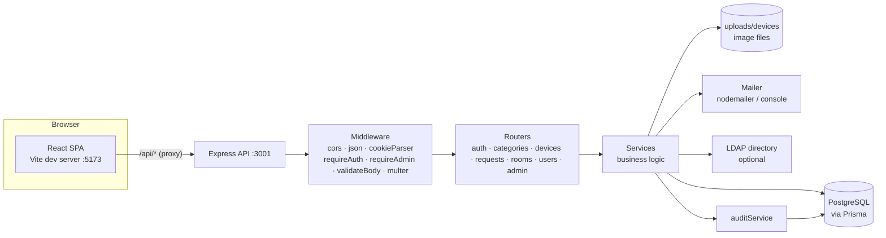
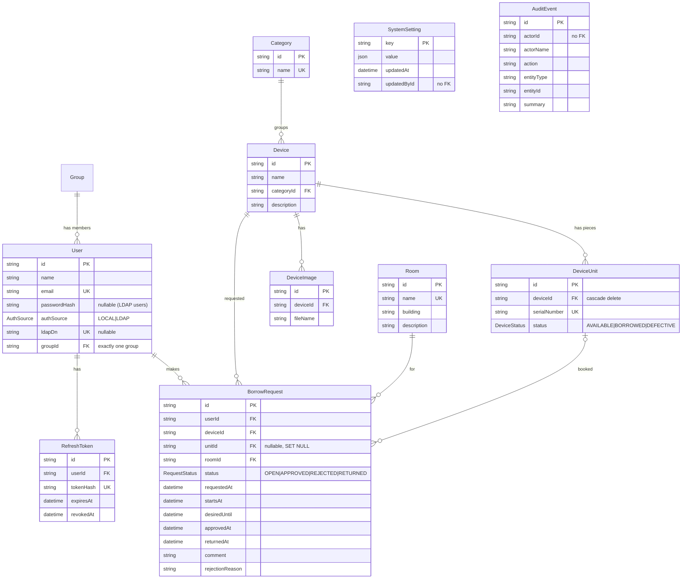
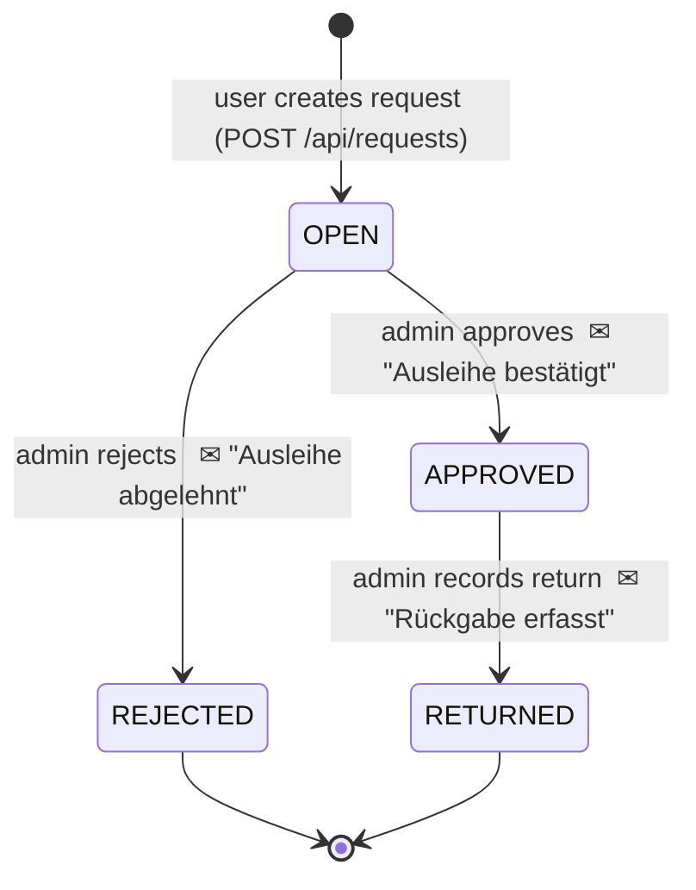
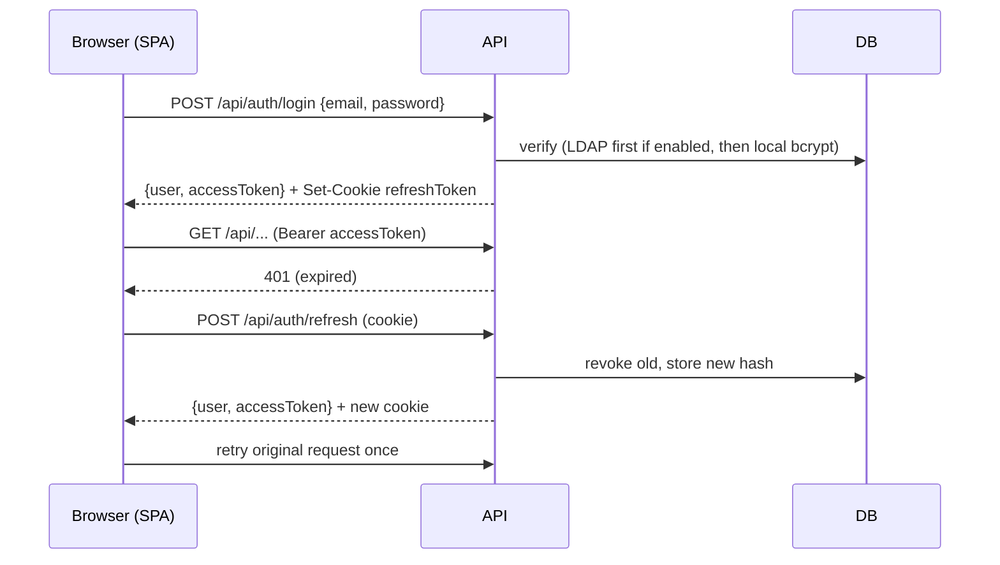

# LendLine — Project Documentation

> Internal IT equipment lending system ("IT-Geräteausleihe").
> Users search for free device units in a time window and request them for a room; administrators ("Verwaltung") approve or reject requests and record returns. Status changes trigger e-mails, and every administrative action is written to an audit log.

The interface, API messages, e-mails and audit log are shown in **German, English, Spanish, Simplified Chinese and Hindi** (§13.9); English is the default language; German is the source language of the interface texts. Everything for developers and operators (logs, startup errors, README, comments) is English. This document is in English and quotes German UI terms where it helps to find them in the code.

---

## Table of contents

1. [At a glance](#1-at-a-glance)
2. [Repository layout](#2-repository-layout)
3. [Getting started](#3-getting-started)
4. [Configuration (environment variables)](#4-configuration-environment-variables)
5. [Architecture](#5-architecture)
6. [Domain model & database](#6-domain-model--database)
7. [Business rules & lifecycles](#7-business-rules--lifecycles)
8. [Authentication & authorization](#8-authentication--authorization)
9. [REST API reference](#9-rest-api-reference)
10. [Backend internals](#10-backend-internals)
11. [E-mail notifications](#11-e-mail-notifications)
12. [Audit log](#12-audit-log)
13. [Frontend](#13-frontend)
14. [Migration history](#14-migration-history)
15. [Known issues, gaps & inconsistencies](#15-known-issues-gaps--inconsistencies)
16. [Glossary (German → English)](#16-glossary-german--english)

---

## 1. At a glance

| Aspect   | Details                                                                                                              |
| -------- | -------------------------------------------------------------------------------------------------------------------- |
| Backend  | Node.js ≥ 20, TypeScript, Express 4, Prisma 6 (PostgreSQL), Zod, JWT, bcrypt, ldapts, multer, nodemailer             |
| Frontend | React 19, React Router 7, Vite 7, TypeScript, plain CSS (no UI library)                                              |
| Database | PostgreSQL 16 (via `docker-compose.yml`)                                                                             |
| Auth     | Short-lived JWT access token (in memory) + rotating refresh token (httpOnly cookie); optional LDAP/Active Directory  |
| Roles    | `USER` (borrower, "Nutzer") and `ADMIN` ("Verwaltung")                                                               |
| Ports    | API `127.0.0.1:3001`, frontend dev server `127.0.0.1:5173` (proxies `/api` to the API)                               |
| Quality  | TypeScript 7 (strict), oxlint (incl. type-aware rules), oxfmt, Prettier (MD/JSON/YAML), knip — see §3 “Code quality” |
| Tests    | None (security audits: `security-audit-1.md`, `fix-report.md`, `security-audit-2.md` in the repository root)         |
| VCS      | Git repository (`main`). The `.venv`/`.idea` folders come from PyCharm, are git-ignored and not used by the app.     |

---

## 2. Repository layout

```
LendLine/
├── README.md                  Quick start
├── docker-compose.yml         PostgreSQL 16 container on 127.0.0.1:5432 (user/db = lendline, password from POSTGRES_PASSWORD, default lendline)
├── .gitignore                 node_modules, dist, .env, backend/uploads, .idea, .venv
├── package.json               Root scripts: dev (database + API + frontend), check (everything), format:docs (Prettier)
├── scripts/start-dev.mjs      `npm run dev`: starts the database if needed, applies migrations, runs API and frontend
├── .oxfmtrc.json              Code formatting (oxfmt), used by the backend
├── .prettierignore            Prettier formats only Markdown/JSON/YAML
├── doc/                       This documentation
├── security-audit-1.md        Security audit, fix-report.md and security-audit-2.md (verification)
│
├── backend/
│   ├── .env / .env.example    Runtime configuration
│   ├── package.json           ESM ("type": "module"); scripts: dev, start, build, typecheck, lint*, format*, knip, check, prisma:*
│   ├── tsconfig.json          Type-check config: NodeNext/ESM, ES2024, strict (+ noUncheckedIndexedAccess …)
│   ├── tsconfig.build.json    Emitting config (rootDir src → dist/)
│   ├── .oxlintrc.json         Lint rules
│   ├── knip.json              Unused files/exports/dependencies
│   ├── prisma/
│   │   ├── schema.prisma      Data model
│   │   ├── seed.ts            Demo users, categories, devices
│   │   └── migrations/        9 SQL migrations (2026-09-23)
│   ├── uploads/devices/       Uploaded device images (served statically)
│   └── src/
│       ├── index.ts           Starts the HTTP server
│       ├── app.ts             Express app, middleware, route mounting, admin endpoints
│       ├── config.ts          Reads & validates environment variables
│       ├── i18n/              Dictionaries de (source), en, es, zh, hi; locales.ts (languages, Accept-Language); index.ts (t, format, messages)
│       ├── lib/               prisma client, HttpError, bcrypt, JWT/refresh tokens, asyncHandler, routeParam, rate limiter, request context
│       ├── middleware/        auth (requireAuth/requireAdmin), validateBody, upload (multer), errorHandler
│       ├── validators/        Zod schemas for auth, devices, requests
│       ├── routes/            auth, categories, devices, requests, rooms, users
│       ├── services/          Business logic (one file per area)
│       └── emails/            mailer, HTML layout/escaping, 3 templates
│
└── frontend/
    ├── index.html
    ├── vite.config.ts         Dev server on 127.0.0.1:5173, /api → http://localhost:3001
    ├── package.json           Scripts: dev, build, preview, typecheck, lint*, format*, knip, check
    ├── tsconfig.json          Single config for src/ and vite.config.ts (strict)
    ├── .oxlintrc.json / .oxfmtrc.json / knip.json
    └── src/
        ├── main.tsx           I18nProvider, BrowserRouter, BrandingProvider, AuthProvider, LocaleBoundary, UiProvider + global CSS
        ├── App.tsx            Route table + route guards
        ├── types.ts           Shared types
        ├── i18n/              Dictionaries de (source), en, es, zh, hi; index.tsx (provider, useI18n, format, dates)
        ├── shortcuts.ts       Keyboard shortcuts (one list for the handler and the help page)
        ├── api/client.ts      fetch wrapper with bearer token + auto refresh (one shared refresh request)
        ├── api/useApi.ts      Data-loading hook: { data, error, reload }
        ├── auth/AuthContext.tsx
        ├── components/        Layout (+ global shortcuts), ui (PageHeader, Field, Alert, Modal), icons, CategorySelect, DeviceImages (+ calendar dialogs), StatusBadge
        ├── pages/             One file per screen (user + admin, HelpPage = „Bedienung“)
        └── styles/global.css
```

---

## 3. Getting started

### Prerequisites

- Node.js 20+
- Docker (for PostgreSQL) or an existing PostgreSQL 16 instance

### First-time setup

```bash
# 1. Database
docker compose up -d

# 2. Backend
cd backend
copy .env.example .env          # Windows; use `cp` on Linux/macOS — then set JWT_ACCESS_SECRET (see §4)
npm install
npx prisma migrate deploy       # apply all migrations
npx prisma db seed              # demo users, categories, devices (loads .env; see below)
npm run dev                     # tsx watch → http://localhost:3001

# 3. Frontend (second terminal)
cd frontend
npm install
npm run dev                     # http://localhost:5173
```

### Demo accounts (created by `prisma/seed.ts`)

| Role                    | E-mail                 | Password     |
| ----------------------- | ---------------------- | ------------ |
| Admin ("IT-Verwaltung") | `admin@lendline.local` | `Admin123!`  |
| User ("Max Mustermann") | `user@lendline.local`  | `User12345!` |

The seed also creates the categories _Laptop, Monitor, Beamer, Zubehör_ and five devices with one unit each (the Epson projector unit `BM-3001` is seeded as `DEFECTIVE`). The seed is idempotent (upserts / "create if missing by name").

- Run it with `npx prisma db seed`: the Prisma CLI loads `backend/.env`. `npm run prisma:seed` calls `tsx prisma/seed.ts` directly, which does **not** load `.env` and fails with "Environment variable not found: DATABASE_URL" unless the variables are set in the shell.
- The seed refuses to run with `NODE_ENV=production`, because the demo passwords are public. It does not run automatically otherwise, but check `NODE_ENV` on real installations (see §15).

Rooms are **not** in the seed; the `rooms` migration inserts `A101`, `B204`, `C12` and a placeholder `Nicht zugeordnet` (`room-unassigned`).

### npm scripts

| Location | Script                                               | Purpose                                                                   |
| -------- | ---------------------------------------------------- | ------------------------------------------------------------------------- |
| root     | `check`                                              | Runs `check` in backend and frontend, then `format:docs`                  |
| root     | `format:docs` / `format:docs:fix`                    | Prettier check / fix for `*.{json,md,yml,yaml}`                           |
| backend  | `dev`                                                | `tsx watch src/index.ts` (hot reload, **no type check**)                  |
| backend  | `start`                                              | `tsx src/index.ts`                                                        |
| backend  | `build`                                              | `tsc -p tsconfig.build.json` → `dist/`                                    |
| backend  | `prisma:generate` / `prisma:migrate` / `prisma:seed` | Prisma helpers                                                            |
| backend  | `db:setup`                                           | `prisma migrate dev --name init` + seed (legacy; prefer `migrate deploy`) |
| frontend | `dev` / `build` / `preview`                          | Vite; `build` runs `tsc --noEmit` first                                   |
| both     | `typecheck`                                          | `tsc --noEmit`                                                            |
| both     | `lint` / `lint:fix`                                  | oxlint, `--max-warnings 0`                                                |
| both     | `lint:types`                                         | oxlint with type-aware rules (`oxlint-tsgolint`), reports unused disables |
| both     | `format` / `format:fix`                              | oxfmt check / fix for code                                                |
| both     | `knip`                                               | Unused files, exports and dependencies                                    |
| both     | `check`                                              | `typecheck` + `lint:types` + `format` + `knip`                            |

### Code quality

Adopted from a shared lint bundle and adapted to this project (2026-09-24). Run everything with
`npm run check` in the repository root; all checks pass with zero warnings.

- **One file, one formatter:** oxfmt formats code (`.ts/.tsx`), Prettier only Markdown/JSON/YAML.
  The backend uses the root `.oxfmtrc.json`; the frontend has its own with a React import group.
  Imports are sorted automatically: type imports, (React), external, internal, relative.
- **TypeScript:** both sides run `strict` plus `noUncheckedIndexedAccess`, `noImplicitReturns`,
  `noImplicitOverride`, `verbatimModuleSyntax` (type-only imports must use `import type`),
  `erasableSyntaxOnly`. The backend is **ESM** (`module: NodeNext`), so relative imports end in
  `.js` (`import { x } from "./y.js"`), even though the source file is `y.ts`.
- **Project-specific lint decisions** (commented in the `.oxlintrc.json` files):
  - `node/no-process-env` is off only for `src/config.ts`, the single place that reads env
    variables. Its `env()` helper treats empty values (`SMTP_HOST=`) as unset.
  - `no-underscore-dangle` allows `_count`/`_all` (Prisma's aggregation API).
  - `prefer-nullish-coalescing` ignores strings, because `""` means "not set" throughout
    (Prisma `@default("")`, empty query params, the "all categories" filter).
  - Frontend: `no-duplicate-imports` allows separate type imports;
    `control-has-associated-label` looks 3 levels deep (row action buttons sit in
    `td > div > button`).
- **Patterns the rules led to:**
  - Backend route handlers are wrapped in `asyncHandler()` (`src/lib/asyncHandler.ts`), which
    forwards rejections to the error handler. No per-route `try/catch`.
  - `routeParam(req, "id")` (`src/lib/params.ts`) reads a required route parameter.
  - Frontend data loading goes through `useApi(path)` (`src/api/useApi.ts`) instead of
    hand-written `useEffect` fetches. Stale responses are dropped, `reload()` refetches.
  - Dialogs are native `<dialog>` elements (`Modal` in `components/ui.tsx`). The browser handles
    focus, Escape, the backdrop and nested dialogs.
- **Not adopted from the bundle:** Vitest rules and test tsconfigs (no tests yet), Tailwind class
  sorting, `@shared/*` paths, and the husky/lint-staged pre-commit hook (not set up yet, although
  the folder is now a git repository).
- **Line endings on Windows:** with `core.autocrlf=true` git checks files out with CRLF, and
  `oxfmt --check` (part of `npm run check`) then reports every such file. Running `oxfmt` rewrites
  them to LF, which git shows as modified although only the line endings changed. Either work with
  `core.autocrlf=input`/`false`, or add a `.gitattributes` with `* text=auto eol=lf`.

---

## 4. Configuration (environment variables)

All read in `backend/src/config.ts`. `DATABASE_URL` and `JWT_ACCESS_SECRET` are required — the process throws on startup if they are missing. `JWT_REFRESH_SECRET` is no longer read (refresh tokens are random values, §8); an old entry does no harm.

Company settings that admins change in the UI (registration, loan rules, request form, e-mail texts, appearance) are not environment variables; they live in `SystemSetting` (§13.6, §13.7).

`JWT_ACCESS_SECRET` must not start with `change-me` (the placeholder in `.env.example`, which is public): that aborts the start in every environment, because `NODE_ENV` is easily left unset. It must also be at least 32 characters; a shorter value aborts with `NODE_ENV=production` and only prints a warning otherwise. Generate one with `node -e "console.log(require('crypto').randomBytes(48).toString('hex'))"`.

| Variable                              | Default                                                                  | Meaning                                                                                                                                                                            |
| ------------------------------------- | ------------------------------------------------------------------------ | ---------------------------------------------------------------------------------------------------------------------------------------------------------------------------------- |
| `DATABASE_URL`                        | — (required)                                                             | PostgreSQL connection string                                                                                                                                                       |
| `JWT_ACCESS_SECRET`                   | — (required)                                                             | HMAC secret for access tokens (HS256); ≥ 32 characters, see above                                                                                                                  |
| `SESSION_MAX_DAYS`                    | `30`                                                                     | A session ends this many days after the login, however often it is refreshed                                                                                                       |
| `JWT_ACCESS_TTL`                      | `15m`                                                                    | Access token lifetime; format `<n>[s                                                                                                                                               | m   | h   | d]`, invalid → 15 min |
| `JWT_REFRESH_TTL_DAYS`                | `7`                                                                      | Refresh token/cookie lifetime in days                                                                                                                                              |
| `PORT`                                | `3001`                                                                   | API port (always bound to `127.0.0.1`)                                                                                                                                             |
| `NODE_ENV`                            | `development`                                                            | `production`: short secret aborts, insecure LDAP aborts, seed refused, `Secure` cookie                                                                                             |
| `FRONTEND_ORIGIN`                     | `http://localhost:5173`                                                  | CORS origin; `https://…` also sets the `Secure` cookie flag; base URL of the logo in e-mails                                                                                       |
| `SMTP_HOST`                           | empty                                                                    | Empty → e-mails are only logged to the console                                                                                                                                     |
| `SMTP_PORT` / `SMTP_SECURE`           | `587` / `false`                                                          |                                                                                                                                                                                    |
| `SMTP_USER` / `SMTP_PASS`             | empty                                                                    | Auth is used only if `SMTP_USER` is set                                                                                                                                            |
| `SMTP_FROM`                           | `LendLine <noreply@lendline.local>`                                      |                                                                                                                                                                                    |
| `LDAP_URL`                            | empty                                                                    | LDAP is enabled only when **both** `LDAP_URL` and `LDAP_BASE_DN` are set                                                                                                           |
| `LDAP_BIND_DN` / `LDAP_BIND_PASSWORD` | empty                                                                    | Service account for the search (anonymous search if empty)                                                                                                                         |
| `LDAP_BASE_DN`                        | empty                                                                    | Search base                                                                                                                                                                        |
| `LDAP_USER_FILTER`                    | `(\|(mail={{username}})(sAMAccountName={{username}})(uid={{username}}))` | `{{username}}` is replaced with the escaped login name                                                                                                                             |
| `LDAP_ADMIN_GROUP`                    | empty                                                                    | Full group DNs, several separated by `;`; membership (`memberOf`) → built-in group „Verwaltung“. Groups can map their own directory groups in the UI. A bare name aborts the start |
| `LDAP_ATTR_EMAIL` / `LDAP_ATTR_NAME`  | `mail` / `displayName`                                                   | Attribute mapping (name falls back to `cn`, then the login name)                                                                                                                   |
| `LDAP_TLS_REJECT_UNAUTHORIZED`        | `true`                                                                   | `false` accepts any certificate (warning; start refused in production)                                                                                                             |
| `LDAP_ALLOW_INSECURE`                 | `false`                                                                  | `true` allows `ldap://` or unchecked certificates in production                                                                                                                    |
| `LDAP_ALLOW_LOCAL_REGISTER`           | `true`                                                                   | `false` disables self-registration while LDAP is enabled                                                                                                                           |
| `ALLOW_DEMO_SEED`                     | —                                                                        | Only for `prisma/seed.ts`: `true` allows the demo accounts outside localhost                                                                                                       |

`docker-compose.yml` reads `POSTGRES_PASSWORD` (default `lendline`); keep `DATABASE_URL` in step with it.

---

## 5. Architecture



**Layering**

- **Routes** (`src/routes/*`) — parse input (Zod via `validateBody` or inline `.parse`), apply `requireAuth`/`requireAdmin`, call a service, send JSON. Async handlers are wrapped in `asyncHandler()`, which passes errors to `next()`; required route params are read with `routeParam(req, "id")`.
- **Services** (`src/services/*`) — all business rules, Prisma queries, transactions, audit writes and e-mail dispatch.
- **Errors** — services throw `HttpError(status, message, code?)`; `errorHandler` maps `HttpError` → its status, `ZodError` → 400 (messages joined), body-parser errors (malformed JSON → 400, body over 100 kB → 413, not logged), anything else → 500 `"Interner Serverfehler"` (logged with stack trace). Responses are always `{ "error": "<message>" }`, plus `code` where set (`MAINTENANCE`, `RATE_LIMITED`).
- **Security headers** — every response carries `X-Content-Type-Options: nosniff`, `X-Frame-Options: DENY` and `Referrer-Policy: no-referrer`; `X-Powered-By` is disabled.
- Prisma error codes are mapped where relevant: `P2002` (unique) → 409, `P2025` (not found) → 404, `P2034` (serialization failure) → 409.

**Static files:** `GET /api/uploads/...` serves `backend/uploads` (relative to the process CWD — start the API from `backend/`). No authentication is required for images.

---

## 6. Domain model & database



### Key concepts

- **Device ("Gerät")** is a _device type/model_ (e.g. "ThinkPad T14"). It has a category, a description, up to 8 images and free **properties** (`Device.fields`, JSON `[{ name, value }]`, e.g. "RAM: 16 GB"; up to 30, names unique per device regardless of case). Users see the properties in the catalogue and the search and can filter by one property and value (exact match, JSONB containment). The editor suggests names and values already in use (`GET /devices/fields`) to keep the free entries consistent.
- **DeviceUnit ("Stück")** is a _physical piece_ with its own unique serial number and status. **Requests are always for a specific unit.** Device-level stock numbers (`quantityTotal`, `quantityAvailable`, …) are computed from its units at read time.
- **Room ("Raum")** — every request names the room in which the device will be used ("Raumbuch").
- **SystemSetting** — key/value store for runtime switches. Keys: `maintenance` = `{ enabled, message, until }` (§8, Maintenance mode), `branding` (logo, colours, font, terms, login page; §13.6), `policy` and `mail` (registration, loan rules, request form, e-mail texts; §13.7).
- **BorrowRequest** — a booking of one unit for a time window `[startsAt, desiredUntil)` in one room. `deviceId` is denormalized from the unit.
- **AuditEvent** — append-only log; `actorName` is copied at write time, so entries survive user deletion.
- IDs are `cuid()` strings (migrations used `md5(...)`/fixed IDs for backfilled rows, e.g. `room-unassigned`).

### Referential behaviour

| Relation                                                | On delete                                         |
| ------------------------------------------------------- | ------------------------------------------------- |
| Device → DeviceUnit / DeviceImage                       | CASCADE                                           |
| User → RefreshToken                                     | CASCADE                                           |
| BorrowRequest → DeviceUnit                              | SET NULL                                          |
| BorrowRequest → User / Device / Room, Device → Category | RESTRICT (services also pre-check and return 409) |

---

## 7. Business rules & lifecycles

### 7.1 Request lifecycle



There is no cancel operation for users and no way to reopen/undo.

### 7.2 Creating a request (`requestService.createRequest`)

Runs in a **Serializable** transaction; a serialization conflict (`P2034`) becomes a 409 "please retry".

1. `startsAt` and `desiredUntil` must match `YYYY-MM-DDTHH:MM` (the format of `<input type="datetime-local">`).
2. `desiredUntil > startsAt`, `desiredUntil` not in the past, `startsAt` not before today 00:00, and at most `rules.maxDays` (default 30) between them.
3. Room and comment follow the company's form settings (required / optional / hidden). An optional or hidden room is stored as `room-unassigned`. Answers to the company's own fields are checked (required, valid choice) and stored with their labels in `BorrowRequest.fields` (`[{ label, value }]`).
4. The person may have at most `rules.maxOpenPerUser` (default 10) `OPEN` requests — counted inside the transaction.
5. The unit must exist and not be `DEFECTIVE`; the room must exist.
6. **No overlap:** no other `OPEN` or `APPROVED` request for the same unit with `startsAt < new.desiredUntil AND desiredUntil > new.startsAt`. Because open requests also block, two users cannot request the same unit for overlapping times.

7. With `rules.autoApprove` the new request goes straight through `approveRequest` (audit: "automatisch bestätigt", approval e-mail).

`POST /requests` is limited to 30 per hour per person.

**Withdrawing:** the requester can withdraw an own `OPEN` request (`POST /requests/:id/cancel` → status `CANCELLED`, `cancelledAt`); it frees the unit at once. Someone else's request answers 404. **Bulk rejection:** `POST /users/:id/requests/reject-open` rejects all open requests of one person without e-mails (for a flood of requests from a misused account).

### 7.3 Approving (`approveRequest`)

- Only `OPEN` requests; re-checks for overlapping `OPEN`/`APPROVED` requests on the same unit and that the unit is not defective.
- Uses `updateMany … where status = OPEN` as an optimistic guard against double processing.
- Sets `approvedAt`, then recomputes unit statuses, sends the approval e-mail, writes the audit entry.
- Approval does not reject other requests: they cannot overlap anyway.

### 7.4 Rejecting (`rejectRequest`)

- Only `OPEN` requests. The API accepts an empty reason (the e-mail then says no reason was given); the **admin UI requires one**.

### 7.5 Returning (`returnRequest`)

- Only `APPROVED` requests; sets `returnedAt` and status `RETURNED`, recomputes unit statuses, sends the return e-mail.
- An early return frees the unit immediately; the remaining booked window is released.

### 7.6 Unit status is derived, not stored authoritatively

`services/unitStatus.ts → refreshUnitStatuses(deviceId?)`:

- `DEFECTIVE` is manual and never touched automatically.
- Every other unit becomes `BORROWED` if an `APPROVED` request covers _now_ (`startsAt ≤ now < desiredUntil`), otherwise `AVAILABLE`.
- This is **lazy**: it runs only on `GET /api/devices`, `GET /api/devices/:id/calendar`, after approve and after return. There is no background job, so an overdue loan (past `desiredUntil`, not yet returned) flips back to `AVAILABLE` on the next refresh even though the request is still `APPROVED`.
- `BORROWED` can never be set manually: create/update device reject it for new units or status changes; a borrowed unit's serial number can still be edited.

### 7.7 Availability search (`searchService.searchFreeUnits`)

Returns every non-defective unit (optionally filtered by category and case-insensitive name substring) that has no `OPEN`/`APPROVED` request overlapping the requested window.

### 7.8 Deletion guards (all → HTTP 409)

| Entity                   | Cannot be deleted when                                                  |
| ------------------------ | ----------------------------------------------------------------------- |
| Category                 | any device uses it                                                      |
| Device                   | any unit is `BORROWED` or any request (any status) references it        |
| Unit (via device update) | it is `BORROWED` or has any request                                     |
| Room                     | any request references it                                               |
| User                     | it's your own account, it's the last admin, or the user has any request |

Additional user rules: nobody changes their own group; at least one user must keep `groups.manage` (§8). The count and the change it guards run in one `Serializable` transaction, so two people removing each other at the same moment cannot leave none (the loser gets 409 "bitte erneut versuchen"). Setting a password through the admin UI ends all of that user's sessions (refresh tokens) and converts an LDAP user to a `LOCAL` user (clears `ldapDn`).

### 7.9 Images

- Admin only, multipart field `images`, max 8 files per upload, 5 MB each, extensions `.jpg .jpeg .png .webp .gif` with an `image/*` MIME type.
- Max 8 images per device in total. Files are stored as `<uuid>.<ext>` in `backend/uploads/devices/`; rejected uploads are removed from disk.
- Deleting an image or device removes the files.

---

## 8. Authentication & authorization

### Tokens

| Token         | Format                                                                      | Storage                                                                                  | Lifetime                        |
| ------------- | --------------------------------------------------------------------------- | ---------------------------------------------------------------------------------------- | ------------------------------- |
| Access token  | JWT (HS256, pinned on sign and verify), payload `{ sub: userId, sv }`       | JS memory in the frontend (`api/client.ts`), sent as `Authorization: Bearer …`           | `JWT_ACCESS_TTL` (15 min)       |
| Refresh token | 48 random bytes, hex; only its **SHA-256 hash** is stored in `RefreshToken` | httpOnly cookie `refreshToken`, `SameSite=Lax`, `Path=/api/auth`, `Secure` in production | `JWT_REFRESH_TTL_DAYS` (7 days) |

**Rotation:** every `/api/auth/refresh` revokes the presented token and issues a new pair. The revocation is atomic (`updateMany … where revokedAt = null`): of two requests presenting the same token only one gets a new pair, the other gets 401. Logout revokes the current token. Expired/revoked rows stay until an admin runs _Abgelaufene Sitzungen bereinigen_ on `/admin/wartung`.

`/auth/refresh` and `/auth/logout` rely on the `SameSite=Lax` cookie and additionally refuse (403) an `Origin` header that is neither `FRONTEND_ORIGIN` nor the request's own host.

**Group, permissions and session version come from the database, not from the JWT:** `requireAuth` loads the user on every request and compares `User.sessionVersion` with the token's `sv`. `services/sessionService.ts → endAllSessions()` raises the version and revokes the refresh tokens; it is used by `/users/:id/sessions/revoke`, the maintenance task "end all sessions", an admin password reset, a group change, the own password change and an LDAP takeover. The affected person is signed out **at once**, not after `JWT_ACCESS_TTL`.

**Reuse detection:** a rotation sets `rotatedAt` on the old token. If such a token comes back more than 60 s later, it was copied (stolen cookie, backup, malware): all sessions of the account end and the log records `SESSION_REUSE_DETECTED`. Within the 60 s it is just a lost race and answers 401. Tokens revoked by logout or an admin have no `rotatedAt` and never trigger this. The frontend serialises refreshes across tabs with the Web Locks API (`navigator.locks`, `api/client.ts`), so two tabs no longer race.

**Maximum lifetime:** every refresh token carries the login time (`sessionStartedAt`), passed on by each rotation. After `SESSION_MAX_DAYS` (30) the session ends and the person logs in again.

### Flow



On page load `AuthProvider` calls `/api/auth/refresh` and then `/api/auth/me` to restore the session.

### Login logic (`authService.login`)

1. If LDAP is enabled, try `authenticateLdap(identifier, password)`:
   - bind with the service account (if configured), search with `LDAP_USER_FILTER` (`sizeLimit 2`; >1 hit → 409),
   - bind as the found DN with the user's password (wrong password → 401),
   - map e-mail/name and the normalised `memberOf` DNs,
   - upsert the local user (matched by `ldapDn` or e-mail) with `authSource=LDAP`, `passwordHash=null`. The group comes from `groupForDirectoryUser()`: the first group (by order) whose directory DNs contain a membership, else `LDAP_ADMIN_GROUP` → „Verwaltung“. As soon as any mapping exists, a user without a matching membership goes to the default group; without mappings an existing user keeps their group and a new one gets the default group.
   - when an existing account changes hands — it was `LOCAL`, or its `ldapDn` differs (e.g. a move between OUs) — all its refresh tokens are revoked first, so a session of someone who registered that e-mail locally does not carry over.
   - Any non-HTTP LDAP failure (server down, etc.) is logged and falls through to local login.
2. Local login: find by lower-cased e-mail; fails if there is no hash, the user is an LDAP user, or bcrypt (12 rounds) does not match. bcrypt always runs (against a dummy hash when the account is missing), so the response time does not reveal whether an account exists.

### Rate limits

In memory, per API process (`lib/rateLimit.ts`, applied in `routes/auth.ts`); over the limit → 429 `{ error, code: "RATE_LIMITED" }`.

| Endpoint              | Limit                                                                                                                                                                       |
| --------------------- | --------------------------------------------------------------------------------------------------------------------------------------------------------------------------- |
| `POST /auth/login`    | 10 attempts / 15 min per IP + account, 50 / 15 min per IP, 50 / 15 min per account across all addresses. A successful login is refunded and resets the IP + account counter |
| `POST /auth/password` | 10 / 15 min per user                                                                                                                                                        |
| `POST /requests`      | 30 / hour per user                                                                                                                                                          |
| `POST /auth/register` | 10 / hour per IP                                                                                                                                                            |

Every attempt is counted before the password check, so parallel requests cannot slip past. The counters reset on restart, and each process counts on its own. IPv6 addresses are counted per /64 network (one connection usually owns a whole /64), IPv4-mapped addresses as IPv4. Keys use `req.ip`, which is only the real client address behind a proxy on loopback that appends `X-Forwarded-For` (Vite in development; configure the production reverse proxy the same way).

### Registration

`POST /api/auth/register` creates a `LOCAL` `USER`. **Registration is off by default** (Einstellungen → Registrierung, `policy.registration.enabled`): an installation reachable from the internet must not accept strangers. Admins can switch it on and limit it to e-mail domains (`policy.registration.domains`, e.g. `firma.de`). It is also blocked when LDAP is enabled and `LDAP_ALLOW_LOCAL_REGISTER=false`. `GET /api/auth/options` tells the login page whether to show the register link. The e-mail address is not verified.

### Own password and temporary passwords

Every local account can change its password on "Mein Konto" (`/konto`, `POST /api/auth/password` with the current password). That ends all sessions and starts a fresh one for the caller. Directory (LDAP) accounts change their password in the directory.

A password an admin chose (new account or reset) is **temporary** (`User.mustChangePassword`): until the person picks their own, `requireAuth` answers every request except `/auth/me` and `/auth/password` with 403 `PASSWORD_CHANGE_REQUIRED`, and the frontend sends them to `/konto`. The user list marks such accounts ("vorläufiges Passwort").

New passwords (registration, admin create/reset) must be 8 characters to 72 bytes UTF-8 — bcrypt ignores everything after 72 bytes. The login password is capped at 200 characters, so older, longer passwords keep working.

### Authorization

**Groups instead of roles.** Every user belongs to exactly one `Group` (migration `20260925140000_groups` created „Verwaltung“ with every permission and „Nutzer“ with `catalog.view` + `requests.create`, and moved former admins and users there). A group holds:

- `permissions`: keys from `backend/src/lib/permissions.ts` (22, in the sections Ausleihe, Anfragen und Ausleihen, Bestand, Benutzer, System). Some imply others (`requests.decide` → `requests.view`, `users.manage` → `users.view`, `requests.create` → `catalog.view`, …); `withImplied()` adds them when saving and when checking.
- `borrowCategoryIds`: categories the members may borrow from (catalogue, search and new requests); empty = all.
- `manageCategoryIds`: categories whose requests, loans, devices and images the members manage (lists are filtered, actions outside answer 403); empty = all.
- `maxDays`, `maxOpenPerUser`, `autoApprove`: the group's loan rules; `null` = company-wide setting.
- `ldapGroupDns`, `isDefault` (exactly one group; registration and new directory users land there), `sortOrder`.

**Checks:**

- `requireAuth` — valid bearer JWT; loads the user **with their group on every request** → `req.user = { id, groupId, permissions, borrowScope, manageScope, rules }`. A change of group or group permissions applies to the next request.
- `requirePermission(...keys)` — any of the keys, else 403. Every route names its permission; `assertManageScope()` and the category lookups in `lib/scope.ts` add the category checks.
- **No escalation:** a group can only be given permissions the acting person holds (`assertGrantable`), a person can only be put into a group whose permissions they hold, and nobody can edit, reset or delete a person whose group has more permissions than their own. Nobody changes their own group.
- **No lock-out:** after every group or user change at least one user must hold `groups.manage` (`assertGroupManagerRemains`, serialisable transaction). The default group cannot be deleted or lose its flag without another default; a group with members is deleted only with `?moveTo=`. A category used in a group scope cannot be deleted (an emptied scope would mean „all“).
- Frontend guards (`Protected`, `GuestOnly` in `App.tsx`) use one table page → permissions (`auth/permissions.ts`); the sidebar, settings tabs, shortcuts, start page (`homePath`) and the login return follow from it. They only affect navigation; the API enforces the real rules.

### Maintenance mode ("Wartungsmodus")

Admins switch it on at `/admin/wartung` with a message and an optional expected end ("Voraussichtlich bis", informational only). While it is on, only admins can use LendLine (`services/maintenanceService.ts`):

- `requireAuth`, login, registration and `/auth/refresh` call `assertAccessDuringMaintenance(permissions)`. Everyone without `maintenance.bypass` gets **503** `{ error: <message>, code: "MAINTENANCE" }`; registration is blocked for everyone.
- The refresh check runs **before** rotation, so a user's refresh token stays valid and their session simply continues after the maintenance without a new login.
- The frontend (`api/client.ts`) fires `lendline:maintenance` on that 503; `AuthProvider` drops the in-memory user, and the login page shows the message from `/auth/options`.
- The setting is cached in memory for 5 s (it is checked on every authenticated request), so a switch takes up to 5 s to apply. With several API processes, each has its own cache.
- Admins see a yellow banner above every page while it is on (`maintenance` flag in `/admin/summary`).

---

## 9. REST API reference

Base path `/api`. JSON in/out. "Auth": 🔓 public, 👤 any logged-in user, 🛡 admin.
Errors: `{ "error": "<message in the request's language>" }` (from `Accept-Language`, English by default) with 400/401/403/404/409/413/500, plus 429 with `code: "RATE_LIMITED"` (login/registration, §8) and 503 with `code: "MAINTENANCE"` during maintenance (§8).

### Health & admin

| Method | Path                                                                          | Auth | Description                                                                                                                                                                                                                                       |
| ------ | ----------------------------------------------------------------------------- | ---- | ------------------------------------------------------------------------------------------------------------------------------------------------------------------------------------------------------------------------------------------------- |
| GET    | `/health`                                                                     | 🔓   | `{ ok: true }`                                                                                                                                                                                                                                    |
| GET    | `/branding`                                                                   | 🔓   | `{ accent, logoUrl, logoDarkUrl, faviconUrl, loginImageUrl, appearance, terms, login }`, read by every page including the login page (§13.6)                                                                                                      |
| GET    | `/settings/request-form`                                                      | 👤   | `{ room, comment, commentLabel, commentHint, fields, maxDays, autoApprove }` for the request dialog                                                                                                                                               |
| GET    | `/admin/summary`                                                              | 🛡    | `{ users, categories, devices, devicesAvailable, devicesBorrowed, devicesDefective, openRequests, activeLoans, maintenance }` (unit counts by stored status; does not refresh statuses first)                                                     |
| GET    | `/admin/audit?q=&category=&action=&actorId=&userId=&from=&to=&cursor=&limit=` | 🛡    | `{ items, nextCursor }`, newest first (default 50, max 200). `category`: requests, devices, masterdata, users, auth, system; `userId`: everything about one person (own actions, account, their requests); `from`/`to`: `YYYY-MM-DD` (whole days) |
| GET    | `/admin/audit/actors`                                                         | 🛡    | People who appear in the log, for the person filter                                                                                                                                                                                               |
| GET    | `/admin/maintenance`                                                          | 🛡    | System status: `{ maintenance, database, app, integrations, counts, sessions, uploads, audit }` (DB latency, uptime, version, SMTP/LDAP, session and orphaned-upload counts)                                                                      |
| PUT    | `/admin/maintenance/mode`                                                     | 🛡    | `{ enabled, message (≤ 500, empty → default text), until ("YYYY-MM-DDTHH:MM" local time or null) }` → the new mode                                                                                                                                |
| POST   | `/admin/maintenance/tasks/:task`                                              | 🛡    | Runs one task → `{ message }`: `cleanup-sessions`, `cleanup-uploads`, `refresh-units`, `test-mail`, `end-sessions` (all except the caller's own); unknown task → 404                                                                              |
| PUT    | `/admin/branding`                                                             | 🛡    | Partial `{ accent?: "#rrggbb" \| null, appearance?, terms?, login? }` → branding                                                                                                                                                                  |
| POST   | `/admin/branding/image/:slot`                                                 | 🛡    | `slot` = `light` \| `dark` \| `favicon` \| `login`; multipart field `image`, SVG/PNG/JPG/WEBP/ICO, ≤ 3 MB, content checked by magic bytes (`lib/imageSniff.ts`) → branding. Replaces and deletes the previous file                                |
| DELETE | `/admin/branding/image/:slot`                                                 | 🛡    | Removes that image and its file → branding                                                                                                                                                                                                        |
| GET    | `/admin/settings/:key`                                                        | 🛡    | `key` = `policy` (registration, rules, request form) \| `mail` (sender name, texts, signature); defaults for everything not saved                                                                                                                 |
| PUT    | `/admin/settings/:key`                                                        | 🛡    | Full object; missing fields fall back to their defaults (`{}` = everything back to default) → stored settings                                                                                                                                     |
| POST   | `/admin/settings/mail/preview`                                                | 🛡    | Unsaved mail settings → `{ subject, html, text }` of the approval mail with sample data                                                                                                                                                           |

### Auth — `/auth`

| Method | Path             | Auth   | Body / notes                                                                                                                         |
| ------ | ---------------- | ------ | ------------------------------------------------------------------------------------------------------------------------------------ |
| GET    | `/auth/options`  | 🔓     | `{ ldapEnabled, allowLocalRegister, registrationDomains, maintenance: { enabled, message?, until? } }`                               |
| POST   | `/auth/register` | 🔓     | `{ name (2–120), email, password (8 chars – 72 bytes) }` → 201 `{ user, accessToken }` + cookie; 409 duplicate e-mail; 429           |
| POST   | `/auth/login`    | 🔓     | `{ email (e-mail or LDAP user name), password (≤ 200) }` → `{ user, accessToken }` + cookie; 429 when rate-limited                   |
| POST   | `/auth/refresh`  | cookie | Rotates the refresh token → `{ user, accessToken }`; 403 on a foreign `Origin`                                                       |
| POST   | `/auth/logout`   | cookie | Revokes the token, clears the cookie → 204; 403 on a foreign `Origin`                                                                |
| POST   | `/auth/password` | 👤     | `{ currentPassword, newPassword }` → `{ user, accessToken }` + new cookie; ends all other sessions; 400 wrong password; 409 LDAP     |
| GET    | `/auth/me`       | 👤     | `{ id, name, email, createdAt, mustChangePassword, locale, authSource, group { id, name }, permissions[] }`                          |
| PUT    | `/auth/locale`   | 👤     | `{ locale: "de" \| "en" \| "es" \| "zh" \| "hi" }` → user; the language of the account's e-mails (allowed with a temporary password) |

### Categories — `/categories`

| Method | Path              | Auth | Notes                                                                                    |
| ------ | ----------------- | ---- | ---------------------------------------------------------------------------------------- |
| GET    | `/categories`     | 👤   | Sorted by name                                                                           |
| POST   | `/categories`     | 🛡    | `{ name (2–80) }` → 201. A duplicate name returns the **existing** category (idempotent) |
| PATCH  | `/categories/:id` | 🛡    | `{ name }`; 409 on duplicate                                                             |
| DELETE | `/categories/:id` | 🛡    | 204; 409 if in use                                                                       |

### Devices — `/devices`

| Method | Path                                                                   | Auth | Notes                                                                                                                                                                                                                                                                                         |
| ------ | ---------------------------------------------------------------------- | ---- | --------------------------------------------------------------------------------------------------------------------------------------------------------------------------------------------------------------------------------------------------------------------------------------------- |
| GET    | `/devices?categoryId=&status=&field=&value=`                           | 👤   | Refreshes unit statuses first. `status` filters devices having **at least one** unit in that status; `field` + `value` keep devices with exactly that property. Admins get all units + `quantityBorrowed`/`quantityDefective`; users only get `AVAILABLE` units. Each device carries `fields` |
| GET    | `/devices/search?startsAt=&desiredUntil=&categoryId=&q=&field=&value=` | 👤   | Free units for a window (see §7.7) → `[{ unitId, serialNumber, deviceId, name, category, description, fields, images }]`                                                                                                                                                                      |
| GET    | `/devices/fields`                                                      | 👤   | Property names in use with their values, sorted (numbers naturally) → `[{ name, values }]`, for suggestions and filters                                                                                                                                                                       |
| GET    | `/devices/:id/calendar`                                                | 👤   | `{ deviceId, name, units: [{ id, serialNumber, status, bookings: [{ id, startsAt, endsAt, state, borrower? }] }] }`. Bookings are OPEN/APPROVED/RETURNED requests (`endsAt` = `returnedAt` for returned ones). Admins also see `borrower` names and defective units                           |
| POST   | `/devices`                                                             | 🛡    | `{ name (2–160), categoryId, description?, fields? [{ name (≤40), value (≤200) }] (≤30), units: [{ serialNumber (2–80), status: AVAILABLE\|DEFECTIVE }] (≥1) }` → 201                                                                                                                         |
| PATCH  | `/devices/:id`                                                         | 🛡    | Any of `name, categoryId, description, fields, units`. `fields` replaces the whole list (changes are logged per property). `units` is the **full desired list**: items with `id` are updated, without `id` created, missing existing ones deleted (subject to §7.8)                           |
| DELETE | `/devices/:id`                                                         | 🛡    | 204; 409 if it has requests or borrowed units                                                                                                                                                                                                                                                 |
| POST   | `/devices/:id/images`                                                  | 🛡    | `multipart/form-data`, field `images` (≤ 8) → 201 list of **all** images `{ id, url }`                                                                                                                                                                                                        |
| DELETE | `/devices/:id/images/:imageId`                                         | 🛡    | 204                                                                                                                                                                                                                                                                                           |

Device response shape (admin):

```json
{
  "id": "…",
  "name": "ThinkPad T14",
  "categoryId": "…",
  "category": "Laptop",
  "description": "…",
  "createdAt": "…",
  "updatedAt": "…",
  "quantityTotal": 3,
  "quantityAvailable": 2,
  "quantityBorrowed": 1,
  "quantityDefective": 0,
  "units": [
    {
      "id": "…",
      "serialNumber": "LT-1001",
      "status": "BORROWED",
      "deviceId": "…"
    }
  ],
  "images": [{ "id": "…", "url": "/api/uploads/devices/<uuid>.jpg" }]
}
```

### Requests — `/requests`

| Method | Path                    | Auth | Notes                                                                                                                                      |
| ------ | ----------------------- | ---- | ------------------------------------------------------------------------------------------------------------------------------------------ |
| GET    | `/requests/mine`        | 👤   | Own requests, newest first                                                                                                                 |
| GET    | `/requests?status=`     | 🛡    | All (or filtered) requests, oldest first                                                                                                   |
| POST   | `/requests`             | 👤   | `{ unitId, roomId?, startsAt: "YYYY-MM-DDTHH:MM", desiredUntil, comment? (≤1000), fields? { [fieldId]: string \| boolean } }` → 201 (§7.2) |
| POST   | `/requests/:id/cancel`  | 👤   | Own `OPEN` request → `CANCELLED`                                                                                                           |
| POST   | `/requests/:id/approve` | 🛡    | → updated request                                                                                                                          |
| POST   | `/requests/:id/reject`  | 🛡    | `{ rejectionReason? (≤1000) }`                                                                                                             |
| POST   | `/requests/:id/return`  | 🛡    | → updated request                                                                                                                          |

Request response shape: all `BorrowRequest` columns plus
`user { id, name, email }`, `unit { id, serialNumber, status } | null`, `room { id, name, building }` and a flattened
`device { id, name, category, serialNumber, status }` (serial/status taken from the unit, `"–"`/`AVAILABLE` if the unit was deleted).

### Rooms — `/rooms`

| Method | Path         | Auth | Notes                                                                        |
| ------ | ------------ | ---- | ---------------------------------------------------------------------------- |
| GET    | `/rooms`     | 👤   | Sorted by name                                                               |
| POST   | `/rooms`     | 🛡    | `{ name (1–80), building? (≤80), description? (≤500) }` → 201; 409 duplicate |
| PATCH  | `/rooms/:id` | 🛡    | Same body (all fields sent; omitted optional fields reset to `""`)           |
| DELETE | `/rooms/:id` | 🛡    | 204; 409 if referenced                                                       |

### Groups — `/groups`

| Method | Path                  | Permission                      | Notes                                                                                                                                                                    |
| ------ | --------------------- | ------------------------------- | ------------------------------------------------------------------------------------------------------------------------------------------------------------------------ |
| GET    | `/groups`             | `users.view` or `groups.manage` | Groups with effective permissions and `members` count, by `sortOrder`                                                                                                    |
| GET    | `/groups/permissions` | `users.view` or `groups.manage` | The permission catalogue (sections, keys, labels, hints) for the group page                                                                                              |
| POST   | `/groups`             | `groups.manage`                 | `{ name, description?, permissions[], borrowCategoryIds[], manageCategoryIds[], maxDays?, maxOpenPerUser?, autoApprove?, ldapGroupDns[], isDefault?, sortOrder? }` → 201 |
| PUT    | `/groups/:id`         | `groups.manage`                 | Same body; 403 for permissions the actor lacks, 409 if nobody could manage groups afterwards                                                                             |
| DELETE | `/groups/:id?moveTo=` | `groups.manage`                 | Members move to `moveTo` first; 409 for the default group                                                                                                                |

### Users — `/users`

Permissions: listing and profile `users.view`; create, change, delete `users.manage`; sign-out and bulk rejection `users.emergency`. Users carry `group { id, name }` instead of a role; `POST`/`PATCH` take `groupId` (missing on create = default group).

| Method | Path                              | Notes                                                                                                          |
| ------ | --------------------------------- | -------------------------------------------------------------------------------------------------------------- |
| GET    | `/users`                          | `{ id, name, email, group { id, name }, authSource, createdAt, mustChangePassword }[]`, by group order         |
| POST   | `/users`                          | `{ name, email, password (8 chars – 72 bytes), groupId? }` → creates a `LOCAL` user with a temporary password  |
| PATCH  | `/users/:id`                      | `{ name?, groupId?, password? }` (e-mail is immutable); a new password ends the user's sessions                |
| DELETE | `/users/:id`                      | Rules in §7.8                                                                                                  |
| GET    | `/users/:id/profile`              | `{ user, activeSessions, lastLogin { createdAt, ip, userAgent }, lastActivityAt, stats, requests }` (API only) |
| POST   | `/users/:id/sessions/revoke`      | Signs that user out everywhere at once (not yourself) → `{ revoked }` (UI: user editor → Sofortmaßnahmen)      |
| POST   | `/users/:id/requests/reject-open` | `{ reason? }` → rejects all open requests of that user without e-mails → `{ rejected }`                        |

---

## 10. Backend internals

| File                                                                   | Responsibility                                                                                                                                |
| ---------------------------------------------------------------------- | --------------------------------------------------------------------------------------------------------------------------------------------- |
| `src/index.ts`                                                         | `createApp().listen(PORT, "127.0.0.1")`                                                                                                       |
| `src/app.ts`                                                           | CORS (single origin, credentials), JSON, cookies, static uploads, routers, `/api/admin/*` endpoints, error handler                            |
| `src/config.ts`                                                        | Env parsing; `ldap.enabled` getter                                                                                                            |
| `lib/prisma.ts`                                                        | Single shared `PrismaClient`                                                                                                                  |
| `lib/errors.ts`                                                        | `HttpError`                                                                                                                                   |
| `lib/password.ts`                                                      | bcrypt hash/verify, 12 rounds                                                                                                                 |
| `lib/tokens.ts`                                                        | JWT sign/verify (HS256 pinned); random refresh token; SHA-256 hashing                                                                         |
| `lib/rateLimit.ts`                                                     | In-memory fixed-window `RateLimiter` (`consume`, `refund`, `reset`) and `clientIp`                                                            |
| `lib/requestContext.ts`                                                | `AsyncLocalStorage` with the caller's IP and user agent, read by the audit log                                                                |
| `middleware/auth.ts`                                                   | `requireAuth` (verifies the JWT, loads user + group from the DB), `requirePermission`, `can`, `assertManageScope`; augments `Express.Request` |
| `middleware/validate.ts`                                               | `validateBody(schema)` — parses and replaces `req.body` (throws `ZodError` → 400)                                                             |
| `middleware/upload.ts`                                                 | multer disk storage + limits; creates the upload dir at import time                                                                           |
| `middleware/errorHandler.ts`                                           | Error → JSON (incl. body-parser errors → 400/413)                                                                                             |
| `validators/*.ts`                                                      | Zod schemas (auth, device, request); categories/rooms/users define their schemas inline in the router                                         |
| `services/authService.ts`                                              | register, login (LDAP + local), refresh, logout, me                                                                                           |
| `services/ldapService.ts`                                              | Directory search/bind, filter escaping, admin-group mapping                                                                                   |
| `services/deviceService.ts`                                            | Device CRUD, unit reconciliation, calendar, public/admin projection (`toPublic`)                                                              |
| `services/searchService.ts`                                            | Free-unit search                                                                                                                              |
| `services/requestService.ts`                                           | Request lifecycle, e-mail dispatch, audit                                                                                                     |
| `services/unitStatus.ts`                                               | Derived `AVAILABLE`/`BORROWED` status                                                                                                         |
| `services/imageService.ts`                                             | Image records + file cleanup                                                                                                                  |
| `services/categoryService.ts`, `roomService.ts`, `userAdminService.ts` | CRUD with guards + audit                                                                                                                      |
| `services/auditService.ts`                                             | `recordAudit` (never throws), `listAudit`                                                                                                     |
| `services/adminSummaryService.ts`                                      | Dashboard counts                                                                                                                              |

**Conventions**

- Audit entries and e-mails are written **after** the DB change and outside the transaction; failures are logged and swallowed, so the main operation always succeeds.
- Dates from `datetime-local` strings are parsed with `new Date("YYYY-MM-DDTHH:MM")`, i.e. in the **API server's local time zone**. Output formatting (e-mails and UI) uses `Europe/Berlin`. The server and users should be in the same time zone.

---

## 11. E-mail notifications

`emails/mailer.ts` creates a nodemailer (v10) transport per message. Without `SMTP_HOST` the message is printed to the console (`[mail] SMTP nicht konfiguriert…`). The sender is `SMTP_FROM`; a company display name from the e-mail settings replaces its name part (the address stays, it must match what the mail server allows).

All mails are built by `emails/format.ts → composeMail()` from `emails/templates.ts`: greeting, one sentence, a table of facts, the company's own text, signature and footer. `mailContext()` loads the company's settings once per sending: mail settings (`SystemSetting` key `mail`), terms (e.g. "Ausrüstung" instead of "Gerät" in the table) and the logo. The logo is shown only if it is PNG/JPG/WEBP (many mail programs do not show SVG) and is linked absolutely via `FRONTEND_ORIGIN`. Company texts are plain text: line breaks are kept, everything is escaped.

| Trigger                        | Subject                        | Contents                                                                                                             |
| ------------------------------ | ------------------------------ | -------------------------------------------------------------------------------------------------------------------- |
| Approve (also auto-approve)    | `Ausleihe bestätigt: <device>` | device, category, serial, period, room (if any), custom field answers, `approvedText` (default: pickup instructions) |
| Reject                         | `Ausleihe abgelehnt: <device>` | device data, reason (or "no reason given"), `rejectedText`                                                           |
| Return                         | `Rückgabe erfasst: <device>`   | device data, return time, `returnedText`                                                                             |
| Maintenance task "Test-E-Mail" | `LendLine: Test-E-Mail`        | greeting, signature, footer                                                                                          |

Every mail is written in the **recipient's language** (`User.locale`, set by the language menu; English when unset), whoever triggers it: `dispatch()` builds one `mailContext(locale)` per language. Built-in texts, dates and the default settings and terms come in that language; a company text that differs from the German default is sent as written (`localizedDefault`). The subjects in the table are the German ones.

No mail is sent when a request is created, withdrawn or bulk-rejected, and admins get no notification of new requests. Admins edit the texts at `/admin/emails` with a live preview (`/admin/settings/mail/preview`, rendered in a `sandbox` iframe).

---

## 12. Audit log

`recordAudit()` (`services/auditService.ts`) writes one `AuditEvent` per action. It never throws: a failed write is logged and the main operation still succeeds.

Each entry stores:

- `actorId` / `actorName`: the acting user, with the name copied at write time. A failed login has no actor; the name is the entered user name.
- `action`, `entityType` (`REQUEST`, `DEVICE`, `CATEGORY`, `ROOM`, `USER`, `AUTH`, `SYSTEM`), `entityId`
- `summary`: one German sentence, including serial numbers where relevant. `recordAudit` takes a message key with parameters (`{ key: "audit.requestApproved", params }`), stores the German sentence (for the search) and keeps the key in `details.i18n`; `listAudit` renders the summary again in the reader's language. Field names and fixed values in `changes`/`context` are translated on reading through `auditTerms`, varying values such as „Stück LT-1001“ or „3 Std. verspätet“ through `auditPatterns`. Entries written before the translation keep their German summary.
- `details` (JSON): `changes` as `[{ field, from, to }]` (unchanged fields are dropped) and `context` as ordered `{ label: value }` facts. Old entries from before 2026-09-24 have no details.
- `ip`, `userAgent`: taken automatically from the current request via `AsyncLocalStorage` (`lib/requestContext.ts`). `trust proxy` is set to loopback, and the Vite proxy forwards `X-Forwarded-For` (`xfwd`).

| Action                                                      | Entity          | Details                                                                                                                   |
| ----------------------------------------------------------- | --------------- | ------------------------------------------------------------------------------------------------------------------------- |
| `DEVICE_CREATED` / `_UPDATED` / `_DELETED`                  | DEVICE          | Name/category/description changes; per piece: added, removed, serial renamed, status change; stock and piece list         |
| `IMAGE_ADDED` / `IMAGE_REMOVED`                             | DEVICE          | File names, size, image count                                                                                             |
| `CATEGORY_*`, `ROOM_*`                                      | CATEGORY / ROOM | Field changes (name, building, description)                                                                               |
| `USER_CREATED` / `_UPDATED` / `_DELETED`                    | USER            | Name, group, sign-in source, "password reset" (never the hash); also LDAP provisioning and directory-driven group changes |
| `USER_REGISTERED`                                           | USER            | Self-registration                                                                                                         |
| `REQUEST_CREATED` / `_APPROVED` / `_REJECTED` / `_RETURNED` | REQUEST         | Status change; device and serial, person, period, room, comment, rejection reason, return time and punctuality            |
| `LOGIN_SUCCEEDED` / `LOGIN_FAILED` / `LOGOUT`               | AUTH            | Method (local account or LDAP); failure reason                                                                            |
| `MAINTENANCE_ON` / `_OFF` / `_UPDATED`                      | SYSTEM          | Message and expected end                                                                                                  |
| `MAINTENANCE_TASK`                                          | SYSTEM          | Task id and result; deleted file names, test-mail recipient and transport                                                 |
| `BRANDING_UPDATED`                                          | SYSTEM          | Accent colour old → new; uploaded logo file name and size; logo removed                                                   |
| `GROUP_CREATED` / `_UPDATED` / `_DELETED`                   | GROUP           | Every changed permission as ja/nein, scopes, rules, directory groups; moved members on delete                             |
| `SETTINGS_UPDATED`                                          | SYSTEM          | Changed settings as `path: old → new` (e.g. `rules.maxDays`)                                                              |
| `REQUEST_CANCELLED`                                         | REQUEST         | Withdrawn by the requester                                                                                                |
| `REQUESTS_BULK_REJECTED`                                    | USER            | Count and reason of the bulk rejection                                                                                    |
| `PASSWORD_CHANGED` / `SESSION_REUSE_DETECTED`               | AUTH            | Own password change; copied refresh token detected (all sessions ended)                                                   |

Token refreshes are not logged (too frequent to be useful).

**UI** (`/admin/protokoll`, `components/AuditTimeline.tsx`): a timeline grouped by day (“Heute”, “Gestern”, …) with an icon per area (green for completed steps, red for deletions, rejections and failures). Each entry can be expanded to show changes as ~~old~~ → **new**, the context facts and the access (IP, browser and OS). Filters: area (Ausleihen, Geräte, Stammdaten, Benutzer, Anmeldungen, System), text search in summary and person, person, date range. 50 entries per page with “Ältere Einträge laden”. The dashboard shows the latest 8 in the same timeline.

---

## 13. Frontend

### 13.1 Bootstrapping & data access

- `main.tsx` → `<BrowserRouter><AuthProvider><App/></AuthProvider></BrowserRouter>`.
- `api/client.ts → api<T>(path, options)`: adds `Content-Type: application/json` (unless `FormData`), the bearer token and `credentials: "include"`; on 401 it calls `refreshSession()` once and retries; throws `ApiError(status, message)` using the server's `error` text; returns `undefined` for 204.
- `refreshSession()` shares one in-flight request between concurrent callers. The server rotates the refresh token on every use, so a second parallel refresh (StrictMode's double effect, several 401s at once) would present an already-revoked token and end the session.
- No state library. Pages load data with `useApi<T>(path)` → `{ data, error, reload }`; mutations call `api()` directly and then `reload()`. Errors appear via `<Alert>`.
- Destructive actions ask for confirmation with `window.confirm`; rejecting a request uses a dialog with a mandatory reason. After approve/return the page calls `refreshNav()` so the sidebar counters update.
- `<Alert>` scrolls itself into view when a new message appears, so an error above a long form (e.g. the device sheet) is never out of sight.

### 13.2 Routes

| Path                      | Page                   | Access | Purpose                                                                                                                                                                                                                           |
| ------------------------- | ---------------------- | ------ | --------------------------------------------------------------------------------------------------------------------------------------------------------------------------------------------------------------------------------- |
| `/login`                  | `LoginPage`            | guests | E-mail/user name + password; hides "Registrieren" if disabled                                                                                                                                                                     |
| `/register`               | `RegisterPage`         | guests | Self-registration                                                                                                                                                                                                                 |
| `/search`                 | `SearchPage`           | users  | **Main booking flow**: quick periods (Heute/Morgen/Rest der Woche/Nächste Woche) or a custom period → free units (shown immediately for tomorrow) → "Kalender & anfragen"; aside with the user's next bookings and a 3-step guide |
| `/devices`                | `DevicesPage`          | users  | Catalog with availability counts, text search, filters, images; clicking a name opens the unit list/calendar                                                                                                                      |
| `/my-requests`            | `MyRequestsPage`       | users  | Own requests with status filter tabs (Alle/Offen/Bestätigt/Abgeschlossen), period, room, rejection reason / return time                                                                                                           |
| `/hilfe`                  | `HelpPage`             | users  | „Bedienung“: mouse/touchpad notes, keyboard basics, all shortcuts (the `g` table lists admin pages only for admins), calendar and image keys                                                                                      |
| `/konto`                  | `AccountPage`          | users  | „Mein Konto“: account data and own password change; forced while the password is temporary                                                                                                                                        |
| `/admin`                  | `AdminHomePage`        | admin  | Summary counts, the 5 oldest open requests, returns due today/overdue, latest 8 audit entries                                                                                                                                     |
| `/admin/devices`          | `AdminDevicesPage`     | admin  | Create/edit devices, manage units (serial + status), upload/remove images                                                                                                                                                         |
| `/admin/categories`       | `AdminCategoriesPage`  | admin  | Category CRUD                                                                                                                                                                                                                     |
| `/admin/rooms`            | `AdminRoomsPage`       | admin  | Room CRUD ("Raumbuch")                                                                                                                                                                                                            |
| `/admin/users`            | `AdminUsersPage`       | admin  | User CRUD, roles, password reset; shows LOCAL/LDAP                                                                                                                                                                                |
| `/admin/requests`         | `AdminRequestsPage`    | admin  | Open requests: approve, or reject with a mandatory reason                                                                                                                                                                         |
| `/admin/borrowed`         | `AdminBorrowedPage`    | admin  | Approved loans: "Als zurückgegeben markieren"                                                                                                                                                                                     |
| `/admin/protokoll`        | `AdminAuditPage`       | admin  | Audit log with action filter                                                                                                                                                                                                      |
| `/admin/erscheinungsbild` | `AdminBrandingPage`    | admin  | Logo (light/dark), accent colour, font, size, corners, sidebar, browser icon, terms, login page text and picture                                                                                                                  |
| `/admin/einstellungen`    | `AdminSettingsPage`    | admin  | Registration (on/off, allowed domains), loan rules (maximum days, open requests per person, auto-approve), request form (room, comment, own fields)                                                                               |
| `/admin/emails`           | `AdminEmailsPage`      | admin  | Sender name, logo, greeting, signature, footer and a text per mail type, with live preview                                                                                                                                        |
| `/admin/wartung`          | `AdminMaintenancePage` | admin  | Maintenance mode (message, expected end), system status, maintenance tasks (clean up sessions and orphaned images, recompute unit status, test e-mail, end all other sessions)                                                    |
| `*`                       | → `/search`            |        |                                                                                                                                                                                                                                   |

After login, admins land on `/admin` and users on `/search`.

### 13.3 How a user books a device

1. **Search** (`/search`): free units for tomorrow 8–17 are shown right away; quick periods or an own period, category, name and property filter. **„Anfragen“** opens the request form with that period (`PieceCalendarDialog` with `startWithRequest`); „Im Kalender ansehen“ switches the same dialog to the calendar.
2. **Catalogue** (`/devices`): „Kalender & anfragen“ opens the piece list, or directly the calendar when only one piece is bookable. The list switches to the calendar in place („← Alle Stücke“ goes back), a free day switches to the form.
3. **Several devices for the same appointment:** above the month grid, _Zeitraum aus meinen Anfragen_ lists the periods of the user's own `OPEN`/`APPROVED` requests that have not ended (one chip per period, the tooltip names the devices). A chip outlines the period and offers _Für diesen Zeitraum anfragen_; the form then gets start, end and — if none is chosen yet — the room of that request. If the unit is already booked then, the bar says _In diesem Zeitraum schon belegt_.
4. Calendar, list and form are **views of one dialog**, never dialogs on top of each other. After sending, the dialog closes and the page shows the confirmation with a link „Zu meinen Anfragen“ (`components/RequestSent.tsx`).

**Navigation rules:** the sidebar shows only pages the person's group may open, „Verwaltung“ first; „Einstellungen“ is one entry for the four tabs Erscheinungsbild, Regeln & Formular, E-Mails, Wartung (`components/SettingsTabs.tsx`; each tab keeps its own URL, so bookmarks and shortcuts stay valid). „Hilfe“ sits next to the theme switch. A logged-out visitor is sent to `/login` with the requested path in the router state and returns there after the login (internal paths only). Unknown paths go to the start page of the group (`homePath`: overview, search or „Meine Anfragen“). Links from the overview carry `?focus=<id>`; the lists scroll to that row and highlight it (`components/useFocusRow.ts`). Every notification e-mail links to `/my-requests`. The findings behind these rules are in `navigation-audit.md`.

### 13.4 Components

| Component          | Notes                                                                                                                                                                                                                                                                                                                                          |
| ------------------ | ---------------------------------------------------------------------------------------------------------------------------------------------------------------------------------------------------------------------------------------------------------------------------------------------------------------------------------------------- |
| `Layout`           | Fixed sidebar (brand, nav groups "Verwaltung" (admins, first) / "Ausleihe" / "Stammdaten" / "System" with icons, help link next to the theme switch, open-request/loan counters and shortcut tooltips, user card with logout); mobile top bar + slide-in menu (Escape closes it); global shortcuts; focus to the page heading after navigation |
| `ui.tsx`           | `PageHeader`, `Field` (label, "optional" marker, hint), `Alert` (scrolls into view), `Modal` (native `<dialog>`, `variant="sheet"` for side panels; see §13.8), `refreshNav()`                                                                                                                                                                 |
| `Logo.tsx`         | `LogoMark` (brand mark "Rücklauf-Schleife": an L whose foot loops back as an arrow; below 20 px without arrowhead) and `Wordmark` ("**Lend**Line"). Favicon: `public/favicon.svg`; e-mails use the text wordmark (SVG is blocked by many mail clients)                                                                                         |
| `icons.tsx`        | Inline SVG icon set (`<Icon name="…" />`)                                                                                                                                                                                                                                                                                                      |
| `CategorySelect`   | Category `<select>` loaded via `useApi`; `emptyLabel` for filters ("Alle Kategorien")                                                                                                                                                                                                                                                          |
| `DeviceImages.tsx` | Despite its name, holds `DeviceImages` (thumbnails), `PieceCalendarDialog` (month grid, own-period chips, request form), `PieceListDialog` and `ImagePopup` (← / → between images)                                                                                                                                                             |
| `StatusBadge`      | `DeviceBadge`, `RequestBadge` (CSS classes `st-<status>`)                                                                                                                                                                                                                                                                                      |

### 13.5 Styling

`styles/global.css` — design tokens in `:root` (neutral zinc greys, `--radius` 4 px / `--radius-sm` 3 px, `--shadow-sm: none`, one flat shadow for dialogs), minimalist tables, square badges and tags (no status dot), form grid (`.form-grid`, `.form-actions`), native-dialog modal (6 px corners, fade-in) and side sheet, calendar table `table.cal-grid` with classes `cal-free/open/borrowed/defective/out/selected`, a 2 px focus outline (1 px line on inputs), skip link, `.sr-only`, `kbd` and help-page styles, reduced-motion support, `scrollbar-gutter: stable`.

Pointer targets: buttons 36 px high (`.sm` 32 px, icon buttons 36/32 px square), sidebar links 36 px, chips, segmented filters, theme switch and colour swatches ≥ 30 px, 8 px between neighbouring action buttons.

**Dark mode:** every colour is a token in `:root`. A dark palette overrides the tokens when the OS prefers dark (unless the user chose _Hell_) or when _Dunkel_ is chosen explicitly (`data-theme` on `<html>`). The two dark blocks in `global.css` must stay identical. The switch _Wie System / Hell / Dunkel_ sits at the bottom of the sidebar (`components/ThemeSwitch.tsx`). The choice is stored per browser in `localStorage` (`lendline-theme`, see `src/theme.ts`), and an inline script in `index.html` applies it before the first paint. Text on the accent colour uses `--accent-contrast`, so the primary buttons and the logo tile invert in dark mode.

---

### 13.6 Branding ("Erscheinungsbild")

LendLine is rented out as **one instance per company** (own installation and database). Each instance's admins adapt it at `/admin/erscheinungsbild`; there is no tenant model. The product name "LendLine" stays.

- **Storage:** `SystemSetting` key `branding` (`services/brandingService.ts`): accent, image file names and the groups `appearance`, `terms`, `login`, each with defaults, so older rows keep working. Images live in `backend/uploads/branding/` (random UUID names, so a new upload never hits a cached old one), served under `/api/uploads/branding/`.
- **Images:** logo (light, optional dark variant), browser icon (favicon; also `.ico`), login picture (≤ 3 MB). The content must match the extension (`lib/imageSniff.ts`), so an HTML file named `.svg` is refused. Everything under `/api/uploads` is sent with `Content-Security-Policy: default-src 'none'; style-src 'unsafe-inline'; sandbox` and `nosniff`.
- **Logo:** `BrandLogo` (`components/Logo.tsx`) shows the company logo up to 32 px high in the sidebar, the mobile top bar and the login/registration pages, replacing mark and wordmark. The dark variant swaps in under the same two conditions as the dark palette.
- **Accent:** `branding/palette.ts` derives `--accent`, `--accent-hover` and `--accent-contrast` for both modes, darkened/lightened until ≥ 3:1 against the surface; the label colour is whichever of white/`#18181b` contrasts more. Saving the default black means "no custom accent".
- **Appearance** (`branding/appearance.ts`): font (standard, system, "Freundlich" = Calibri, serif, rounded; local fonts only, nothing is downloaded), size (`zoom` 0.93/1/1.1 on `body`, because `global.css` sizes in px), corners (`--radius`/`--radius-sm`), sidebar (neutral, tinted, or in the accent colour — then the sidebar gets its own token set).
- **Terms:** subtitle under "LendLine", catalogue name, device/devices, unit/units, room/rooms (`useTerms()`). Used where a word stands alone: navigation, page titles, table headers, the request dialog, e-mail tables. Sentences with articles were rephrased neutrally so that any word fits ("Nichts frei in diesem Zeitraum").
- **Login page:** title, welcome text and a picture left of the form (hidden below 820 px).
- **No flash:** `BrandingProvider` starts from the branding cached in `localStorage` (`lendline-branding`), loads `/api/branding` on start and after every save. The generated CSS (`lendline-branding-css`) and the icon URL (`lendline-branding-icon`) are applied by the inline script in `index.html` before the first paint. The CSS uses `html:root` / `html .x`, so it outranks `global.css` whatever the order of the style elements.

### 13.7 Company settings (`/admin/einstellungen`, `/admin/emails`)

`services/settingsService.ts` stores two more `SystemSetting` rows, validated with zod, each field with a default and cached for 5 s:

- `policy`: `registration { enabled (false), domains [] }`, `rules { maxDays (30), maxOpenPerUser (10), autoApprove (false) }`, `form { room, comment (required | optional | hidden), commentLabel, commentHint, fields [] }`. Up to 10 own fields: text, multi-line text, choice list or checkbox; required or optional; with a hint. A field keeps its id when renamed; answers are stored with the label of that moment (§7.2).
- `mail`: `senderName`, `showLogo`, `greeting`, `signature`, `footer`, `approvedText`, `rejectedText`, `returnedText` (§11).

Every change is logged as `SETTINGS_UPDATED` with the changed paths. A row that no longer validates (e.g. edited by hand) falls back to the defaults.

### 13.7a Settings mode ("Einstellungsmodus", `/admin/modus`)

A company chooses how much of the administration it sees: **Einfach**, **Mittel**, **Voll** or **Eigene Auswahl** (`SystemSetting` key `ui` = `{ mode, custom }`, permission `settings.mode`; installations without the setting are in „Voll“). The areas and which preset includes them are listed once in `backend/src/lib/uiFeatures.ts`:

| Area                                                                        | Einfach | Mittel | Voll |
| --------------------------------------------------------------------------- | ------- | ------ | ---- |
| Erweitertes Erscheinungsbild (font, form, sidebar, icon, terms, login page) | –       | ✓      | ✓    |
| Ausleihregeln                                                               | –       | ✓      | ✓    |
| Anfrageformular anpassen                                                    | –       | ✓      | ✓    |
| E-Mail-Texte                                                                | –       | ✓      | ✓    |
| Gruppen und Rechte                                                          | –       | ✓      | ✓    |
| Erweiterte Gruppeneinstellungen (categories, rules, LDAP per group)         | –       | –      | ✓    |
| Geräte-Eigenschaften (editor, tags, filter)                                 | –       | ✓      | ✓    |
| Protokoll                                                                   | –       | ✓      | ✓    |
| Wartung                                                                     | –       | –      | ✓    |

Always shown: logo, accent colour, self-registration, users, devices, categories, rooms, requests and loans.

The mode **only hides** interface parts (menu entries, tabs, cards, editor sections); it is not a permission. What is configured in a hidden area keeps working, and the API still accepts changes from people with the permission. `GET /api/ui` (everyone signed in) returns mode, effective areas and the catalogue; the frontend reads it through `ui/UiContext.tsx` (`useFeature`, `useCanOpen`, which combines permissions and areas for guards, menu, tabs and shortcuts). `GET /api/admin/ui/usage` lists areas that differ from their defaults, so the mode page warns „Ausgeblendet, aber weiter wirksam“ before such an area disappears.

### 13.8 Keyboard

Everything is reachable with Tab/Shift+Tab; every action is a real `<button>` or link. The help page `/hilfe` explains it for users.

| Where        | Keys                                                                                                                                                                                                                                                        |
| ------------ | ----------------------------------------------------------------------------------------------------------------------------------------------------------------------------------------------------------------------------------------------------------- |
| Anywhere     | `?` help page · `/` search field of the page (`[data-shortcut="search"]`) · `n` create (`[data-shortcut="new"]`: button is clicked, input focused) · `g` + letter jumps to a page (`src/shortcuts.ts`, e.g. `g g` Geräte, `g k` Katalog)                    |
| Dialogs      | Focus starts in the first field; `Esc` closes; `Ctrl/Cmd+Enter` submits the dialog's form (also from a textarea); focus returns to the opener on close                                                                                                      |
| Calendar     | One Tab stop (roving `tabIndex`, WAI-ARIA grid pattern); arrows ±1 day / ±1 week, `Home`/`End` Monday/Sunday, `PageUp`/`PageDown` month, `Enter` picks a free day. Taken days use `aria-disabled` (not `disabled`) so they stay focusable and are announced |
| Image viewer | `←` / `→`                                                                                                                                                                                                                                                   |
| Mobile menu  | Focus moves into the menu on open; `Esc` closes it                                                                                                                                                                                                          |

Rules: shortcuts never fire while typing in a field (`isTyping`) or while a dialog is open; after every route change the page `<h1>` gets focus (`tabIndex=-1`, no outline). Open dialogs share one scroll lock (a module-level counter in `Modal`), so nested dialogs may close in any order without leaving the page unscrollable.

### 13.9 Languages

Five languages: German (source), English, Spanish, Simplified Chinese, Hindi. `frontend/src/i18n/de.ts` and `backend/src/i18n/de.ts` hold the German texts; the other files are typed `Messages` (`typeof de`), so a missing or extra key fails the type check.

- **Choice:** saved in `localStorage` (`lendline-locale`), else English, the default language (the browser language is not used). Language menus: sidebar footer, login and registration pages, "My account". When signed in, the choice is saved to the account (`PUT /auth/locale`) for the e-mails; a device without its own choice takes the account's.
- **Server texts:** `api()` sends `Accept-Language`; the server answers errors, validation messages (Zod issues map to `validation.*` keys or generic messages), the permission and settings-mode catalogues, maintenance task results and the audit log in that language. `LocaleBoundary` mounts the app again on a change, so everything is fetched anew.
- **Placeholders and plurals:** `"{name}"`, `{ one, other }` chosen by `{count}` with `Intl.PluralRules`; `"{unit:lower}"` lower-cases a company term inside an English or Spanish sentence. Dates, weekdays and numbers use `Intl` with the language (time zone Europe/Berlin).
- **Company texts:** stored defaults are German. A value equal to the German default counts as "not adapted" and is shown in the reader's language (terms, login title, comment field, maintenance notice, e-mail texts); editors show it translated and store the German default again when it is saved unchanged. Everything a company writes itself (names, descriptions, own terms and texts) shows as written in every language.
- **Audit 2:** `localization-audit-2.md` lists the checks and the remaining limits.

---

## 14. Migration history

The migrations are dated 2026-09-23 to 25 and show how the model evolved:

| Migration                         | Change                                                                                                                                                                                                                                  |
| --------------------------------- | --------------------------------------------------------------------------------------------------------------------------------------------------------------------------------------------------------------------------------------- |
| `…000000_init`                    | `User`, `Device` (with `category` text, `serialNumber`, `status`), `BorrowRequest`, `RefreshToken`                                                                                                                                      |
| `…120000_ldap`                    | `AuthSource` enum, `User.authSource`, `User.ldapDn`; `passwordHash` nullable                                                                                                                                                            |
| `…140000_categories`              | `Category` table, backfilled from `Device.category`; `Device.categoryId` FK + index; drops the text column                                                                                                                              |
| `…160000_device_images`           | `DeviceImage`                                                                                                                                                                                                                           |
| `…180000_audit`                   | `AuditEvent`                                                                                                                                                                                                                            |
| `…190000_device_stock`            | Temporary `quantityTotal`/`quantityBorrowed` counters on `Device`                                                                                                                                                                       |
| `…200000_device_units`            | **`DeviceUnit`** introduced: one unit per former device plus generated `<serial>-n` units for extra stock; approved requests are mapped to borrowed units; `BorrowRequest.unitId`; removes serial/status/quantity columns from `Device` |
| `…210000_request_times`           | `BorrowRequest.startsAt` (backfilled from `requestedAt`)                                                                                                                                                                                |
| `…220000_rooms`                   | `Room` table + 4 rows; `BorrowRequest.roomId` (existing rows → `room-unassigned`)                                                                                                                                                       |
| `20260924120000_audit_details`    | `AuditEvent.details`, `ip`, `userAgent`                                                                                                                                                                                                 |
| `20260924150000_system_settings`  | `SystemSetting` (key/value, used for the maintenance mode)                                                                                                                                                                              |
| `20260925100000_session_security` | `User.sessionVersion`, `User.mustChangePassword`, `RefreshToken.sessionStartedAt`                                                                                                                                                       |
| `20260925110000_token_rotation`   | `RefreshToken.rotatedAt` (reuse detection)                                                                                                                                                                                              |
| `20260925120000_request_form`     | `RequestStatus.CANCELLED`, `BorrowRequest.cancelledAt`, `BorrowRequest.fields` (JSON)                                                                                                                                                   |
| `20260925130000_device_fields`    | `Device.fields` (JSON, free properties)                                                                                                                                                                                                 |
| `20260925150000_settings_mode`    | Adds the permission `settings.mode` to „Verwaltung“                                                                                                                                                                                     |
| `20260925140000_groups`           | `Group` table with „Verwaltung“ and „Nutzer“, `User.groupId` (backfilled from the role), drops `User.role` and the `Role` enum                                                                                                          |
| `20260925160000_user_locale`      | `User.locale` (nullable text): language of the interface and the e-mails                                                                                                                                                                |

---

## 15. Known issues, gaps & inconsistencies

State after security audit 3 and its fixes of 2026-09-25 (details in `security-audit-3.md` and `fix-report-3.md`). `npm run
check` passes apart from the CRLF formatting noise on Windows checkouts (§3).

### Functional inconsistencies

- **Unit status is lazy** (§7.6): `/api/admin/summary` and `/api/devices/search` don't refresh it first, so dashboard counts can be stale; overdue loans show as `AVAILABLE` while the request is still `APPROVED`. There is no overdue detection or reminder.
- **Reject reason**: optional in the API, mandatory in the UI.
- Schema drift: migration `…140000_categories` creates `Device_categoryId_idx`, but `schema.prisma` has no `@@index([categoryId])` on `Device`. The next `prisma migrate dev` will try to drop that index.
- Admin category creation with a duplicate name returns the existing category with HTTP 201 instead of 409.
- `npm run prisma:seed` does not load `.env` (use `npx prisma db seed`, §3).
- `/users/:id/profile` exists in the API but has no UI.
- Localization limits (see `localization-audit-2.md`): the audit search matches German wording only; Chinese and Hindi texts need a review by native speakers; company terms are inserted without grammatical gender or case (Spanish, Hindi).

### Security / operational notes

- **`NODE_ENV` matters:** it defaults to `development`. The placeholder secret is refused everywhere; the `Secure` cookie follows `FRONTEND_ORIGIN` (https) and the demo seed refuses any non-local origin. The short-secret abort and the insecure-LDAP abort still need `NODE_ENV=production`, so always set it on real installations.
- LDAP: accounts are still matched by e-mail as a fallback; a second directory entry with the same `mail` takes over the account's data and group (sessions are revoked). Needs a stable directory key (`objectGUID`/`entryUUID`) and a migration.
- Rate limits are in memory and per process (§8).
- Uploaded images are publicly readable under `/api/uploads/…` without authentication (intended for logos, which the login page needs; device photos are public too).
- Registration (off by default) does not verify the e-mail address; the domain list limits who can register.
- `prisma` (dev dependency) pulls in `deepmerge-ts < 8` (GHSA-ggr8-5vv4-36mx); CLI only.
- The API binds to `127.0.0.1` only; a production deployment needs a reverse proxy that also serves the built frontend (no production serving setup exists).
- Time handling depends on the server time zone (§10).
- `backend/.env` exists locally; it is git-ignored — make sure real secrets never end up in `.env.example`.
- No automated tests, no CI, no pre-commit hook (lint/format/typecheck are set up, see §3).

## 16. Glossary (German → English)

| German (UI / code)                            | English                                                   |
| --------------------------------------------- | --------------------------------------------------------- |
| Gerät                                         | Device (model/type)                                       |
| Stück                                         | Unit / physical piece                                     |
| Seriennummer                                  | Serial number                                             |
| Verfügbar / Ausgeliehen / Defekt              | Available / Borrowed / Defective                          |
| Anfrage                                       | (Borrow) request                                          |
| Offen / Bestätigt / Abgelehnt / Zurückgegeben | Open / Approved / Rejected / Returned                     |
| Ausleihe                                      | Loan / lending                                            |
| Rückgabe                                      | Return                                                    |
| Raum / Raumbuch / Gebäude                     | Room / room register / building                           |
| Kategorie                                     | Category                                                  |
| Verwaltung                                    | Administration (the built-in group with every permission) |
| Nutzer / Benutzer                             | User                                                      |
| Protokoll                                     | Audit log                                                 |
| Übersicht                                     | Dashboard / overview                                      |
| Anmelden / Abmelden / Registrieren            | Log in / Log out / Register                               |
| Verzeichnis                                   | Directory (LDAP)                                          |
| Ablehnungsgrund                               | Rejection reason                                          |
